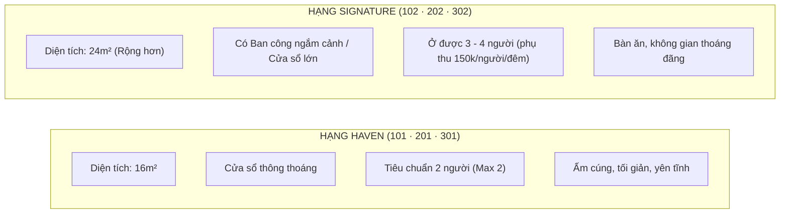

# 02. Danh Mục Hạng Phòng & Cơ Sở Vật Chất (Meta Catalog)

Toàn bộ Every Inn gồm **6 phòng khép kín** được phân thành 2 hạng phòng chính: **Haven** và **Signature**. Toàn bộ các phòng đều có **nhà vệ sinh riêng biệt**.

---

## 1. So Sánh 2 Hạng Phòng

### 1.1. Hạng Signature (Phòng 102 · 202 · 302)
- **Đặc trưng**: Phòng rộng hơn hẳn, có **ban công để ngắm cảnh** (hoặc cửa sổ lớn mặt tiền đón ánh sáng tự nhiên).
- **Diện tích**: 24 m² (cả 3 phòng 102, 202, 302).
- **Sức chứa**: Tiêu chuẩn 2 người. **Mọi phòng Signature (102, 202, 302)** nhận tối đa **4 người** (khách thứ 3–4 phụ thu **150.000đ/người/đêm**). Phòng 302 có thêm sofa bed.
- **Tiện nghi trong phòng**:
  - Giường lớn nệm cao cấp + Sofa bed thư giãn.
  - Smart TV màn hình lớn / Máy chiếu HD Beecube kết nối Wifi tốc độ cao.
  - Điều hoà Inverter êm ái, tủ lạnh mini, ấm đun nước, máy sấy tóc.
  - Bộ bàn ghế ăn, rèm đôi cản nắng chống UV.
  - Phòng tắm khép kín, nước nóng lạnh năng lượng mặt trời.

### 1.2. Hạng Haven (Phòng 101 · 201 · 301)
- **Đặc trưng**: Thiết kế gọn gàng, ấm cúng, **có cửa sổ thông thoáng**.
- **Diện tích**: 16 m². Tối đa 2 người (không nhận khách thứ 3).
- **Sức chứa**: Tiêu chuẩn **2 người** (Cấm nhận khách thứ 3).
- **Tiện nghi trong phòng**:
  - Giường đôi đệm êm cao cấp, drap trắng thay mới 100% sau mỗi lượt khách.
  - Máy chiếu HD sắc nét hoặc Smart TV.
  - Điều hoà Inverter, tủ lạnh mini, ấm đun nước, máy sấy tóc.
  - Nhà vệ sinh riêng khép kín, khăn tắm, dầu gội & sữa tắm đầy đủ.

---

## 2. Tiện Ích Tòa Nhà & Cơ Sở Vật Chất Sử Dụng Chung
- **Bãi giữ xe máy**: Khu vực để xe máy an toàn bên trong nhà ở tầng trệt (hoàn toàn miễn phí).
- **Bãi xe ô tô**: Khách đi ô tô có thể đậu tại các hẻm xung quanh bán kính 300m hoặc bãi giữ xe ô tô ở đường lớn Nguyễn Công Hoan / Phan Xích Long.
- **Khu giặt sấy miễn phí**: Máy giặt, máy sấy quần áo hiện đại và sân phơi chung dành cho khách lưu trú.
- **Lưu ý đặc biệt**: **Tòa nhà sử dụng CẦU THANG BỘ, KHÔNG CÓ THANG MÁY**. (Cần lưu ý nhắc trước đối với khách có vali quá nặng hoặc người lớn tuổi đi lại khó khăn).
- **Hình thức nhận phòng**: **Tự nhận phòng 24/7 (Self Check-in)** bằng mật khẩu cổng và thẻ từ hộp khóa số riêng tại cửa phòng.

---

## 3. Quy Tắc Gửi Link Ảnh Phòng Cho Khách (Rule 4 Meta Agent)
> [!IMPORTANT]
> **Quy định nghiêm ngặt từ Meta Business Agent**:
> Khi khách hàng yêu cầu xem ảnh phòng, **hãy cung cấp thông tin mô tả về 2 hạng phòng Haven và Signature, sau đó đính kèm link website chính thức**:  
> 👉 [`https://saigonliving.hi-everyinn.workers.dev/`](https://saigonliving.hi-everyinn.workers.dev/)  
> *(Tuyệt đối tránh gửi các đường dẫn mạng xã hội riêng lẻ hoặc những dòng chữ điều hướng xem thêm ảnh cụ thể cho từng hạng phòng).*
