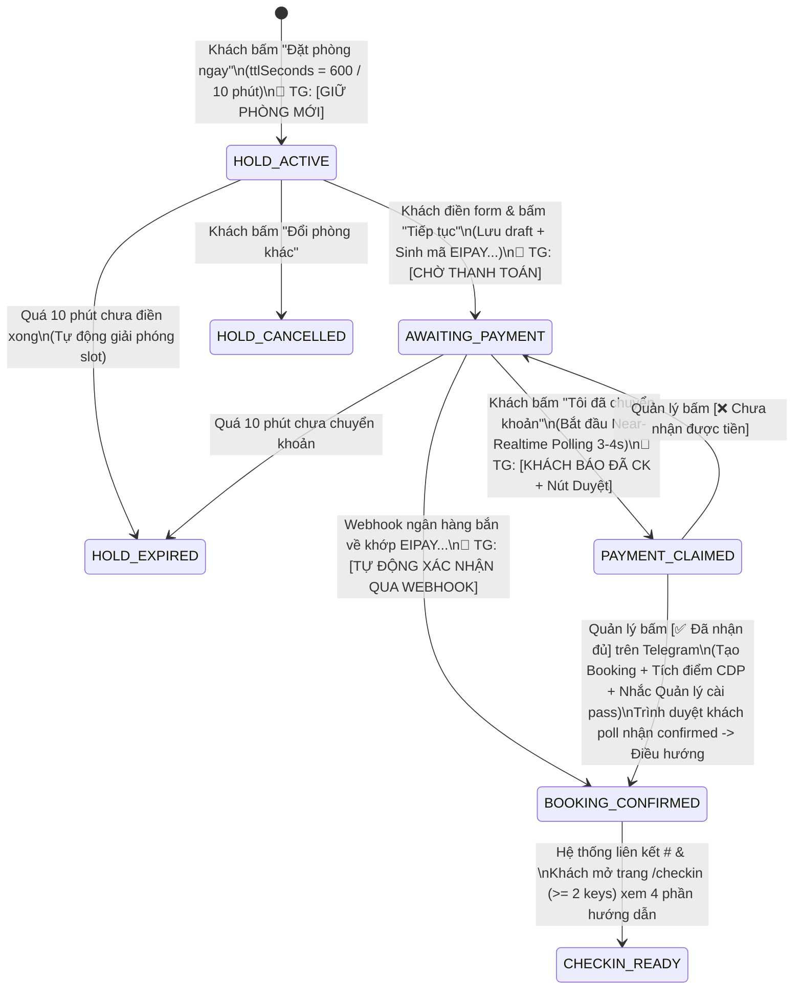

# Data Model & State Machines: Guest Self-Booking, Payment & Check-in Guide

- **Branch**: `001-guest-self-booking`
- **Date**: 2026-04-20
- **Version**: 2.0.0 (Updated to Core Pricing v2.0, Real-world Operational Metrics & Edge Security)
- **Last Updated**: 2026-11-08
- **Spec**: [spec.md](file:///Users/lap14666/Documents/private/every%20inn/van%20hanh/booking-page/every-inn-booking/specs/001-guest-self-booking/spec.md)

---

## 1. Cross-Database Ownership Matrix

Tuân thủ nguyên tắc cô lập dữ liệu trong `everyinn-platform-docs/CONVENTIONS.md`, dữ liệu của tính năng tự đặt phòng được phân bổ rõ ràng trên 3 cơ sở dữ liệu D1:

| D1 Database | Owner Worker | Bảng liên quan | Vai trò trong luồng Khách tự đặt phòng |
| :--- | :--- | :--- | :--- |
| **`BOOKING_DB`** | `everyinn-booking-core` | `rooms`, `inventory_slots`, `room_holds`, `bookings`, `promotions`, `promotion_redemptions`, `manual_financial_entries`, `cdp_sync_outbox`, `booking_audit_events`, `domain_versions`, `calendar_rate_overrides`, `booking_configs`, `room_blocks` | Kiểm tra lịch trống + tính toán `overnightAddons` (đơn giá 60k/h), giữ chỗ 10 phút (`ttl_seconds = 600`), tính giá Core v2.0 (Public & Private Promos, Calendar Overrides), quản lý Stop-Sell/Mở phòng, kiểm tra Rolling Advance Window, chốt đơn `confirmed`, ghi sổ tài chính và đẩy sự kiện sang CDP. |
| **`CDP_DB`** | `everyinn-cdp-core` | `customers`, `customer_identifiers`, `loyalty_rule_sets`, `stamp_cycles`, `stamp_entries` | Tra cứu khách hàng theo `phone` (E.164 `+84...`) để lấy hạng thẻ (`not_member`, `bronze`, `silver`, `gold`), kiểm tra phần thưởng tích tem (`EVERYINN_STAMP_10_V1`), và tích lũy tem/đêm sau khi thanh toán. |
| **`AGENT_DB`** | `everyinn-agent-core` | `gate_codes`, `room_lockbox_codes`, `booking_code_overrides`, `escalations`, `landing_payment_verifications` | Lưu trữ mã hóa AES-GCM cho `<pass_cổng>#` & `<pass lock box>`, chuẩn bị mã trước khi khách đến, gửi thông báo + xử lý nút bấm xác nhận trên Telegram cho Quản lý (Human Manager), và giải mã trả về khi khách tra cứu `/checkin`. |

---

## 2. Core Data Transfer Objects (DTOs)

### 2.1. `OvernightAddonsDTO` (Mở rộng trong `AvailabilityRoomResult`)
Khi `bookingType === 'overnight'`, mỗi phòng trong kết quả tìm kiếm trả về thêm trường `overnightAddons` với đơn giá **`60.000đ/giờ`**:

```typescript
export type OvernightShiftCode = '21-9' | '22-10' | '23-11' | '24-12';

export interface OvernightAddonOption {
  hours: 1 | 2 | 3;
  type: 'early_checkin' | 'late_checkout';
  label: string;              // VD: "Thêm 1h checkin sớm (nhận 21:00)" | "Thêm 2h checkout muộn (trả 11:00)"
  shortLabel: string;         // VD: "+1h checkin sớm" | "+2h checkout muộn"
  effectiveTimeIso: string;   // Mốc checkinAt hoặc checkoutAt mới nếu chọn nút này
  surchargeVnd: number;       // 60000 * hours
  available: boolean;         // true nếu toàn bộ slot liên tiếp + 60p dọn phòng đều trống
  unavailableReason?: 'SLOT_OCCUPIED' | 'TURNOVER_BUFFER_CONFLICT';
}

export interface OvernightAddonsDTO {
  shift: OvernightShiftCode;
  baseCheckinAt: string;      // ISO +07:00 của ca cơ bản đã chọn
  baseCheckoutAt: string;     // ISO +07:00 của ca cơ bản đã chọn
  maxEarlyAllowedByRule: 0 | 1 | 2 | 3;
  maxLateAllowedByRule: 0 | 1 | 2 | 3;
  surchargePerHour: 60000;    // Cố định 60.000đ / giờ
  earlyCheckinOptions: OvernightAddonOption[];  // Độ dài mảng = maxEarlyAllowedByRule (0..3)
  lateCheckoutOptions: OvernightAddonOption[];  // Độ dài mảng = maxLateAllowedByRule (0..3)
}
```

#### Quy tắc số lượng phần tử mảng theo từng ca:
1. **Ca `21-9` (`21:00 -> 09:00`)**:
   - `earlyCheckinOptions`: `[]` (0 nút, không nhận trước 21h)
   - `lateCheckoutOptions`: Tối đa 3 nút (`+1h checkout muộn (10h)`, `+2h (11h)`, `+3h (12h)`)
2. **Ca `22-10` (`22:00 -> 10:00`)**:
   - `earlyCheckinOptions`: Tối đa 1 nút (`+1h checkin sớm (21h)`)
   - `lateCheckoutOptions`: Tối đa 2 nút (`+1h checkout muộn (11h)`, `+2h (12h)`)
3. **Ca `23-11` (`23:00 -> 11:00`)**:
   - `earlyCheckinOptions`: Tối đa 2 nút (`+1h checkin sớm (22h)`, `+2h (21h)`)
   - `lateCheckoutOptions`: Tối đa 1 nút (`+1h checkout muộn (12h)`)
4. **Ca `24-12` (`00:00 -> 12:00`)**:
   - `earlyCheckinOptions`: Tối đa 3 nút (`+1h checkin sớm (23h)`, `+2h (22h)`, `+3h (21h)`)
   - `lateCheckoutOptions`: `[]` (0 nút, không trả sau 12h trưa)

---

### 2.2. Promotion & Loyalty DTOs (Core v2.0 Stacking)

```typescript
export type LoyaltyTier = 'not_member' | 'bronze' | 'silver' | 'gold';

export interface PromotionSummaryDTO {
  id: string;
  code: string | null;        // null nếu là Public Promotion
  name: string;
  isPublic: boolean;          // true: ưu đãi công khai; false: mã riêng tư
  discountType: 'percentage' | 'fixed_amount';
  discountValue: number;
  maxDiscountAmount: number | null;
  discountApplied: number;    // VND giảm thực tế (chỉ tính trên Base Price)
}

export interface LoyaltyRewardSummaryDTO {
  available: boolean;
  tier: LoyaltyTier;
  milestoneStep: number | null;
  rewardValue: number;        // Ví dụ: 50.000, 100.000, 150.000đ từ tích tem
  label: string | null;
  rewardApplied: number;      // VND giảm thực tế (sau khi đã trừ promo, không âm)
}

export interface PricingBreakdownDTO {
  basePrice: number;          // P_base gốc theo bảng giá hạng phòng
  promotionDiscount: number;  // D_promo
  loyaltyDiscount: number;    // D_loyalty
  holidaySurcharge: number;   // S_holiday
  extraHourFee: number;       // S_extra_hours = extraHours * 60.000đ
  extraGuestFee: number;      // S_extra_guests (nếu Signature >= 3 khách)
  subtotal: number;           // basePrice + holiday + extraHours + extraGuests
  totalPrice: number;         // max(0, basePrice - promo - loyalty) + surcharges
}
```

---

### 2.3. `Holds` & `Bookings` State Machine (10-Minute TTL + Near-Realtime Polling)



---

### 2.4. Rate Limiting Data Structures (`rateLimit.ts`)

```typescript
export interface RateLimitEntry {
  count: number;
  resetAtMs: number;
}

export type RateLimitAction = 'SEARCH' | 'CREATE_HOLD' | 'NOTIFY_PAID' | 'CHECKIN_LOOKUP';

export interface RateLimitConfig {
  limit: number;
  windowSec: number;
}
```

---

### 2.5. Cấu trúc Dữ liệu Xác thực Đa Khóa & Hướng dẫn Check-in (`/checkin`)

#### Request: `GuestCheckinLookupRequest`
Khách phải cung cấp **Khóa 1 (`phone`)** kết hợp với **ít nhất 1 khóa thứ hai** trong danh sách:
```typescript
export interface GuestCheckinLookupRequest {
  /** Khóa 1 (Bắt buộc): Số điện thoại di động Việt Nam đã đặt phòng */
  phone: string;

  /**
   * Khóa 2 (Bắt buộc ít nhất 1 trong các tùy chọn):
   */
  bookingCodeOrPaymentRef?: string; // Mã đơn "EI-..." hoặc mã thanh toán "EIPAY..."
  socialHandle?: string;            // Username/Link Zalo, Instagram, Facebook đã nhập lúc đặt
  checkinDateAndRoom?: {            // Ngày nhận phòng (YYYY-MM-DD) + Số phòng (101..302)
    checkinDate: string;
    roomId: string;
  };
}
```

#### Response: `GuestCheckinGuidePayload`
Khi xác thực thành công ($\ge 2$ khóa trùng khớp), API trả về:

```typescript
export interface GuestCheckinGuidePayload {
  booking: {
    id: string;
    roomId: string;               // <số phòng> (VD: "202")
    roomName: string;             // VD: "Signature 202"
    bookingType: 'hourly' | 'overnight' | 'dayuse';
    checkinAt: string;            // ISO +07:00
    checkoutAt: string;           // ISO +07:00
    numGuests: number;
    guestNameMasked: string;      // VD: "Nguyễn V** A"
  };
  accessCodes: {
    ready: boolean;               // true nếu đã có mã cổng & hộp khóa
    gateCode: string | null;      // <pass_cổng> (VD: "1234")
    gateCodeFormatted: string | null; // "<pass_cổng>#" (VD: "1234#")
    lockboxCode: string | null;   // <pass lock box> (VD: "5678")
    wifiSsid: string;             // "DGH"
    wifiPassword: string;         // "0906314109"
    pendingNote?: string;
  };
  /**
   * 4 phần nội dung chuẩn theo đúng thứ tự cố định của Every Inn
   */
  guideBlocks: {
    step1MainText: string;        // Toàn bộ văn bản hướng dẫn đã thay <pass_cổng>#, <số phòng>, <pass lock box>
    step1GoogleMapsUrl: string;   // "https://maps.app.goo.gl/CV7RM9akRpGEx8Ds8?g_st=ic"
    step2Images: {
      checkinImageUrl: string;    // "/checkin-guide/checkin-guide.jpg"
      checkinImageAlt: string;
      checkoutImageUrl: string;   // "/checkin-guide/checkout-guide.jpg"
      checkoutImageAlt: string;
    };
    step3TaxiText: string;        // "Nếu bạn đi taxi hãy book xe đến 71/31 Nguyễn Công Hoan là đầu hẻm, và mình đi bộ vào khoảng 30m như clip hướng dẫn là đến ạ"
    step3TaxiDropoffAddress: string; // "71/31 Nguyễn Công Hoan, Phường Cầu Kiệu, Phú Nhuận, TP.HCM"
    step4Video: {
      videoUrl: string;           // "/checkin-guide/taxi-alley-guide.mp4"
      posterUrl: string;          // "/checkin-guide/checkin-guide.jpg"
      caption: string;
    };
  };
}
```

---

## 3. D1 Schema & Database Extensions (`BOOKING_DB`)

### 3.1. DDL Bảng `calendar_rate_overrides` (Dynamic Daily Rate Overrides)
Bảng ghi đè giá bán cơ bản theo ngày, phục vụ tính năng điều chỉnh giá trực tiếp trên Calendar OTA:

```sql
CREATE TABLE IF NOT EXISTS calendar_rate_overrides (
  id TEXT PRIMARY KEY,                       -- UUID v4
  property_id TEXT NOT NULL,                -- 'everyinn-phunhuan'
  room_id TEXT,                             -- NULL nếu áp dụng cho toàn bộ hạng phòng; hoặc 'hav-101'..'sig-302'
  room_class TEXT NOT NULL,                 -- 'haven' | 'signature'
  rate_plan_code TEXT NOT NULL,             -- 'hourly_combo3h' | 'overnight_standard' | 'daily_standard'
  override_date TEXT NOT NULL,              -- 'YYYY-MM-DD' theo giờ VN (+07:00)
  custom_base_price INTEGER NOT NULL,       -- Giá cơ bản mới (VNĐ), thay thế P_base trong Core v2.0
  note TEXT,                                -- Ghi chú nội bộ (VD: "Giá Black Friday", "Chốt khách quen")
  is_active INTEGER NOT NULL DEFAULT 1,     -- 1: Bật; 0: Tắt (khôi phục giá gốc)
  version INTEGER NOT NULL DEFAULT 1,       -- Optimistic concurrency lock
  created_at TEXT NOT NULL,                 -- ISO UTC
  updated_at TEXT NOT NULL                  -- ISO UTC
);

-- Index tối ưu truy vấn kiểm tra giá trong < 1ms CPU
CREATE UNIQUE INDEX IF NOT EXISTS uq_rate_override_scope
  ON calendar_rate_overrides (property_id, COALESCE(room_id, '__ALL__'), room_class, rate_plan_code, override_date);

CREATE INDEX IF NOT EXISTS idx_rate_overrides_lookup
  ON calendar_rate_overrides (property_id, room_class, rate_plan_code, override_date)
  WHERE is_active = 1;
```

### 3.2. Cấu hình Cửa Sổ Nhận Đặt Trước Luân Phiên (`booking_configs`)
Thêm trường `max_advance_days` vào bảng cấu hình hệ thống:

```sql
-- Migration bổ sung nếu bảng đã tồn tại
ALTER TABLE booking_configs ADD COLUMN max_advance_days INTEGER NOT NULL DEFAULT 90;

-- Hoặc DDL đầy đủ
CREATE TABLE IF NOT EXISTS booking_configs (
  property_id TEXT PRIMARY KEY,             -- 'everyinn-phunhuan'
  max_advance_days INTEGER NOT NULL DEFAULT 90, -- 60 (2 tháng), 90 (3 tháng), 180 (6 tháng), 365 (1 năm)
  min_advance_hours INTEGER NOT NULL DEFAULT 0,  -- Số giờ báo trước tối thiểu (0 = cho phép đặt ngay)
  turnover_minutes INTEGER NOT NULL DEFAULT 60,  -- Bất biến 60 phút dọn phòng
  updated_at TEXT NOT NULL
);
```

### 3.3. Quản Trị Đóng / Mở Bán Phòng (`room_blocks`)
Bảng ghi nhận các khoảng thời gian đóng phòng chủ động (Stop-Sell / Bảo trì / Chủ nhà ở):

```sql
CREATE TABLE IF NOT EXISTS room_blocks (
  id TEXT PRIMARY KEY,                       -- UUID v4
  property_id TEXT NOT NULL,                -- 'everyinn-phunhuan'
  room_id TEXT NOT NULL,                    -- 'hav-101'..'sig-302' hoặc '*' (tất cả phòng)
  block_type TEXT NOT NULL,                 -- 'stop_sell' | 'maintenance' | 'owner_stay' | 'deep_cleaning'
  start_at TEXT NOT NULL,                   -- ISO +07:00
  end_at TEXT NOT NULL,                     -- ISO +07:00
  reason TEXT,                              -- Diễn giải cho nhân viên
  created_by TEXT NOT NULL,                 -- 'admin-dashboard' | 'telegram-owner'
  created_at TEXT NOT NULL,
  updated_at TEXT NOT NULL
);

CREATE INDEX IF NOT EXISTS idx_room_blocks_window
  ON room_blocks (property_id, room_id, start_at, end_at);
```

---

## 4. OTA Calendar Extranet Data Transfer Objects (DTOs)

### 4.1. `CalendarMatrixDTO` (Ma trận Lịch phòng & Giá bán)
Dữ liệu hiển thị lưới ngày x phòng trên giao diện Quản trị:

```typescript
export interface CalendarDateCellDTO {
  date: string;                             // 'YYYY-MM-DD'
  isWithinAdvanceWindow: boolean;           // true nếu date <= today + max_advance_days
  isStopSell: boolean;                      // true nếu phòng bị đóng bán trong ngày
  stopSellReason?: 'stop_sell' | 'maintenance' | 'owner_stay' | 'deep_cleaning';
  blockId?: string;
  occupancyStatus: 'vacant' | 'occupied' | 'partial_hold' | 'turnover_blocked';
  baseRates: {
    hourly_combo3h: number;                 // VNĐ
    overnight_standard: number;             // VNĐ
    daily_standard: number;                 // VNĐ
  };
  activeOverrides: {
    id: string;
    ratePlanCode: 'hourly_combo3h' | 'overnight_standard' | 'daily_standard';
    customBasePrice: number;
    note?: string;
  }[];
}

export interface CalendarRoomRowDTO {
  roomId: string;                           // 'hav-101'..'sig-302'
  roomName: string;                         // 'Haven 101'..'Signature 302'
  roomClass: 'haven' | 'signature';
  dates: Record<string, CalendarDateCellDTO>; // Key là YYYY-MM-DD
}

export interface CalendarMatrixResponseDTO {
  propertyId: string;
  startDate: string;                        // YYYY-MM-DD
  endDate: string;                          // YYYY-MM-DD
  maxAdvanceDays: number;                   // Cấu hình hiện tại (VD: 90)
  maxAdvanceDateAllowed: string;            // Ngày xa nhất khách có thể đặt
  rooms: CalendarRoomRowDTO[];
}
```

### 4.2. `RateOverrideInputDTO` & `StopSellInputDTO`

```typescript
export interface RateOverrideInputDTO {
  propertyId: string;
  roomClass: 'haven' | 'signature';
  roomId?: string | null;                   // null = áp dụng toàn hạng phòng
  ratePlanCode: 'hourly_combo3h' | 'overnight_standard' | 'daily_standard';
  startDate: string;                        // 'YYYY-MM-DD'
  endDate: string;                          // 'YYYY-MM-DD' (hỗ trợ áp dụng theo dải ngày)
  customBasePrice: number;                  // VNĐ
  note?: string;
}

export interface StopSellInputDTO {
  propertyId: string;
  roomIds: string[];                        // Danh sách phòng cần đóng (['*'] nếu tất cả)
  blockType: 'stop_sell' | 'maintenance' | 'owner_stay' | 'deep_cleaning';
  startDate: string;                        // 'YYYY-MM-DD' hoặc ISO
  endDate: string;                          // 'YYYY-MM-DD' hoặc ISO
  reason?: string;
}

export interface AdvanceBookingConfigDTO {
  propertyId: string;
  maxAdvanceDays: 60 | 90 | 180 | 365 | number; // 2 tháng, 3 tháng, 6 tháng, 1 năm
}
```
