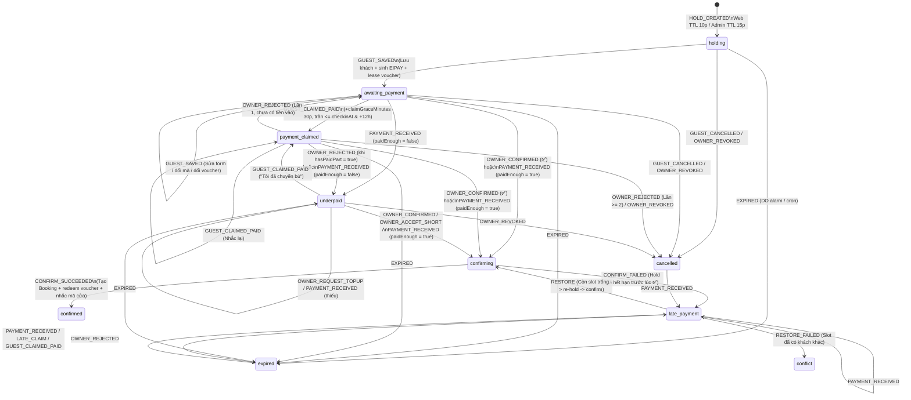

# Data Model & State Machines: Guest Self-Booking, Payment & Check-in Guide

- **Branch**: `feat/landing-self-booking` (Spec-Kit `001-guest-self-booking`)
- **Version**: 3.0.0 (Aligned 100% with [source-of-truth.md](./source-of-truth.md) and actual codebase)
- **Last Updated**: 2026-11-10
- **Spec**: [spec.md](./spec.md)
- **Shared DTO Source**: [shared/booking-kit/types.ts](file:///Users/lap14666/Documents/private/every%20inn/van%20hanh/booking-page/everyinn-platform-docs/shared/booking-kit/types.ts) · [stay.ts](file:///Users/lap14666/Documents/private/every%20inn/van%20hanh/booking-page/everyinn-platform-docs/shared/booking-kit/stay.ts)

---

## 1. Cross-Database Ownership Matrix

Tuân thủ nguyên tắc cô lập dữ liệu trong [CONVENTIONS.md](file:///Users/lap14666/Documents/private/every%20inn/van%20hanh/booking-page/everyinn-platform-docs/CONVENTIONS.md), dữ liệu của Landing Self-Booking & Session Engine thống nhất (Web + Admin) phân bổ trên 3 cơ sở dữ liệu D1:

| D1 Database | Owner Worker | Bảng liên quan (mới / mở rộng) | Vai trò trong luồng Đặt phòng & Vận hành |
| :--- | :--- | :--- | :--- |
| **`BOOKING_DB`** | `everyinn-booking-core` | `properties`, `rooms`, `rate_rules`, `surcharge_rules`, `booking_configs` (`booking_rules`, `overnight_shifts`, `hourly_checkin_slots`), `inventory_slots` (2 lanes `occupancy` & `turnover`), `room_holds` (+`channel`, `session_id`), `bookings` (+`channel`, `session_id`, `voucher_code`, `voucher_value`), `promotions`, `promotion_redemptions`, `rate_overrides` (migration `0011`), `room_blocks` (+`block_type`), `manual_financial_entries` (+`external_ref`), `booking_audit_events` (+`caller`), `domain_versions`, `cdp_sync_outbox` | Cửa hàng công khai (`/storefront`), kiểm tra lịch trống + `overnightAddons` (`60.000đ/giờ`) trong 1 batch slot query, kiểm tra cửa sổ đặt trước (`booking_rules.max_advance_days`, ngày dương lịch VN), tính giá Core v2.0 + `rate_overrides` + `stackDiscounts`, giữ chỗ + chốt đơn `confirmed`, chặn `409 SESSION_MANAGED` nếu sửa hold thuộc session từ caller ngoài `agent-core`. |
| **`CDP_DB`** | `everyinn-cdp-core` | `customers`, `customer_identifiers`, `loyalty_rule_sets`, `stamp_cycles`, `stamp_entries`, `customer_vouchers` (migration `0004`) | Tra cứu khách theo SĐT E.164 `+84...` (`loyalty-context`), trả hạng thẻ (`not_member`, `bronze`, `silver`, `gold`) và ví voucher; phát hành voucher thưởng tích tem (`TEM<step>-XXXX`), lease voucher theo hold (`reserve`/`release`), đánh dấu `redeemed` khi chốt đơn và hoàn `issued` khi đơn `cancelled` (giữ `redeemed` nếu `no_show`). |
| **`AGENT_DB`** | `everyinn-agent-core` | `booking_sessions`, `session_events` (append-only), `session_payments` (append-only), `payment_intents`, `payment_webhook_inbox`, `rate_counters` (migration `0021`), `master_data` (`booking_channels`, `checkin_guide`, `payment_policy` SEED 11), `gate_codes`, `room_lockbox_codes`, `booking_code_overrides`, `escalations` | Động cơ **Booking Session Engine** cho cả `web` và `admin` (tuần tự qua Durable Object `BookingSessionLive`), điều phối `InventoryPulse`, lưu SHA-256 `token_hash` (không lưu raw token), đếm `phone_hash` / `ip_hash` / `rate_counters`, nhận webhook ngân hàng (`sepay`/`casso`/`payos`), xử lý thẻ Telegram `ss:`/`sm:`, lưu mã hoá AES-GCM mã cổng/hộp khoá và giải mã có điều kiện cửa sổ thời gian tại `/checkin`. |

---

## 2. Core Data Transfer Objects (`shared/booking-kit` & Session Engine)

### 2.1. `Storefront` & `OvernightAddons` (`shared/booking-kit/types.ts`, `stay.ts`)

```typescript
export type StayKind = "hourly" | "overnight" | "dayuse";

export interface OvernightShift {
  code: string;   // "21-9" | "22-10" | "23-11" | "24-12"
  start: string;  // HH:MM ("00:00" = rạng sáng sau ngày đêm D)
  end: string;    // HH:MM (sáng hôm sau D+1)
  label: string;  // "21h – 9h" ...
}

export interface Storefront {
  catalogVersion: number;
  bank: { bankId: string | null; account: string | null; holderName: string | null } | null;
  rooms: {
    id: string;        // "haven-101".."haven-301", "sig-102".."sig-302"
    roomNumber: string;
    name: string;
    roomClass: "haven" | "signature";
    floor: number;
    areaSqm: number | null;
    maxGuests: number;
  }[];
  rates: Record<
    "haven" | "signature",
    { combo3h: number | null; overnight: number | null; dayroom: number | null; extraHourFee: number }
  >;
  extraGuest: { standardGuests: number; feePerGuest: number; roomClasses: string[] };
  hourly: { minHours: number; firstCheckin: string; lastCheckin: string; slots: number[] };
  overnight: { window_start: string; window_end: string; max_addon_hours: number; shifts: OvernightShift[] };
  dayuse: { checkin: string; checkout: string };
  bookingWindow: { today: string; maxAdvanceDays: number; maxDate: string; minLeadMinutes: number };
  publicPromotions: {
    id: string;
    name: string;
    discountType: "percentage" | "fixed_amount";
    discountValue: number;
    description: string | null;
  }[];
}
```

> **Lưu ý dữ liệu phòng**: ID thật trong `BOOKING_DB.rooms` là `haven-101`, `haven-201`, `haven-301`, `sig-102`, `sig-202`, `sig-302`. Seed `BOOKING_DB` ghi `area_sqm` là `22` / `28` m², còn marketing copy trên Landing (`src/data/rooms.ts`) hiển thị `16` m² (Haven) / `24`–`30` m² (Signature); thẻ kết quả tìm kiếm ưu tiên `roomMedia(roomNumber).area` từ Landing và hiển thị tiêu đề `Phòng {roomNumber}`.

```typescript
export interface AddonOption {
  hours: number;
  type: "early_checkin" | "late_checkout";
  shortLabel: string;        // "+1h nhận sớm" | "+2h trả muộn"
  label: string;             // "Thêm 1h nhận phòng sớm (nhận 21:00)"
  effectiveTimeIso: string;  // UTC ISO
  surchargeVnd: number;      // 60000 * hours (extra_hour_fee)
  available: boolean;
  unavailableReason?: "SLOT_OCCUPIED" | "TURNOVER_BUFFER_CONFLICT" | "IN_THE_PAST";
}

export interface SearchRoom {
  room: {
    id: string;
    roomNumber: string;
    name: string;
    roomClass: "haven" | "signature";
    maxGuests: number;
    areaSqm: number | null;
    floor: number;
  };
  available: boolean;
  reasons: { code: string; message: string }[]; // Public reason: "JUST_BOOKED" ("Vừa được đặt") hoặc "TOO_MANY_GUESTS"
  price: {
    basePrice: number;
    subtotal: number;
    extraGuestFee: number;
    extraFee: number;
    holidaySurcharge: number;
    total?: number;
    promotion?: { name: string; discount: number } | null;
    lines: { code: string; label: string; amount: number }[];
  } | null;
  overnightAddons?: {
    shift: string;
    maxEarlyAllowedByRule: number;
    maxLateAllowedByRule: number;
    surchargePerHour: number; // 60000
    earlyCheckinOptions: AddonOption[];
    lateCheckoutOptions: AddonOption[];
  } | null;
}

export interface SearchResult {
  bookingsVersion: number;
  checkinAt: string;
  checkoutAt: string;
  bookingWindow: { maxAdvanceDays: number; maxDate: string };
  warnings?: { code: string; message: string }[];
  shiftSummary?: {
    code: string;
    label: string;
    checkinAt: string;
    checkoutAt: string;
    availableRooms: number;
    past: boolean;
  }[];
  rooms: SearchRoom[];
}
```

#### Ma trận nút thêm giờ qua đêm (`booking_configs['overnight_shifts']`):
Khung biên `[window_start, window_end]` mặc định `[21:00, 12:00]`, `max_addon_hours = 3`:

| Ca cơ bản | `earlyCheckinOptions` tối đa | `lateCheckoutOptions` tối đa | Đơn giá |
|---|---|---|---|
| `21-9` (`21:00 → 09:00`) | `0` nút | `3` nút (`+1h` `10:00`, `+2h` `11:00`, `+3h` `12:00`) | `60.000đ/giờ` |
| `22-10` (`22:00 → 10:00`) | `1` nút (`+1h nhận sớm` `21:00`) | `2` nút (`+1h` `11:00`, `+2h` `12:00`) | `60.000đ/giờ` |
| `23-11` (`23:00 → 11:00`) | `2` nút (`+1h` `22:00`, `+2h` `21:00`) | `1` nút (`+1h trả muộn` `12:00`) | `60.000đ/giờ` |
| `24-12` (`00:00 → 12:00`) | `3` nút (`+1h` `23:00`, `+2h` `22:00`, `+3h` `21:00`) | `0` nút | `60.000đ/giờ` |

*(Thuật toán liên tiếp: nếu bậc $k$ bị vướng `IN_THE_PAST`, `SLOT_OCCUPIED` hoặc `TURNOVER_BUFFER_CONFLICT`, mọi bậc $> k$ tự động `available: false`)*

---

### 2.2. Booking Session DTO (`SessionView`), `Preview` & Voucher Wallet

```typescript
export type SessionStatus =
  | "holding"
  | "awaiting_payment"
  | "payment_claimed"
  | "underpaid"
  | "confirming"
  | "confirmed"
  | "expired"
  | "cancelled"
  | "late_payment"
  | "conflict";

export const LIVE_STATUSES: SessionStatus[] = [
  "holding",
  "awaiting_payment",
  "payment_claimed",
  "underpaid",
];

export interface SessionView {
  ref: string;                        // Mask id hoặc public ref (không lộ raw secret token)
  channel: "web" | "admin" | "chat";
  status: SessionStatus;
  statusLabel: string;                // Khớp STATUS_LABEL trong machine.ts
  room: { id: string; label: string };
  bookingType: string;
  shift: string | null;
  checkinAt: string;                  // UTC ISO
  checkoutAt: string;                 // UTC ISO
  earlyHours: number;
  lateHours: number;
  numGuests: number;
  expiresAt: string;                  // UTC ISO
  serverNow: string;                  // UTC ISO để client tính đồng hồ lệch chuẩn
  remainingSeconds: number;
  amountDue: number;
  paidAmount: number;
  remaining: number;
  pricing: {
    basePrice: number | null;
    subtotal: number;
    promotion: { name: string; discount: number } | null;
    voucher: { codeMasked: string; label: string; discount: number } | null;
    total: number;
    payable: number;
    isDeposit: boolean;
  } | null;
  guest: {
    name: string | null;
    phoneMasked: string | null;
    phone?: string | null;            // Chỉ trả đầy đủ cho AdminApi; web nhận phoneMasked
    zalo?: string | null;
    instagram: string | null;
    facebook: string | null;
    note: string | null;
  } | null;
  payment: {
    bankId: string | null;            // Đọc động từ BOOKING_DB.properties
    account: string | null;
    holderName: string | null;
    amount: number;
    reference: string;                // "EIPAY<YYMMDD><4CHAR>"
    qrUrl: string | null;
  } | null;
  bookingId: string | null;
  can: { editGuest: boolean; claimPaid: boolean; cancel: boolean };
  timeline: { event: string; label: string; at: string }[]; // Chỉ gồm session_events.public = 1
  version: number;                    // Optimistic version cho long-poll ?v= và ETag
}

export interface Preview {
  pricing: {
    basePrice: number;
    surcharges: number;
    lines: { code: string; label: string; amount: number }[];
    subtotal: number;
    promotion: { name: string | null; eligible: boolean; reason: string | null; discount: number } | null;
    voucher: { id: string; codeMasked: string; label: string; discount: number } | null;
    total: number;
  };
  member: { tier: string | null; found: boolean | null } | null;
  vouchers: {
    id: string;
    codeMasked: string;
    value: number;
    label: string;
    expiresAt: string;
    code?: string | null;             // Bị ẩn trên web (mask = true)
  }[];
}
```

#### Công thức Stacking (`stackDiscounts`, `everyinn-booking-core/src/domain/pricing.ts`):
```text
capBase       = min(basePrice, subtotal)
promo         = min(max(0, promoDiscount), capBase)
remainingBase = max(0, capBase - promo)
loyalty       = min(max(0, voucher), min(remainingBase, max(0, subtotal - promo)))
total         = max(0, subtotal - promo - loyalty)
```
Khuyến mãi (`promo`) và voucher ví (`loyalty`) chỉ được trừ tối đa trong phần giá cơ bản `capBase`, tuyệt đối không trừ lấn vào phụ thu giờ thêm (`extraFee`), phụ thu khách (`extraGuestFee`) hoặc phụ thu lễ (`holidaySurcharge`).

---

## 3. Booking Session State Machine (`everyinn-agent-core/src/sessions/machine.ts`)

10 trạng thái (`SESSION_STATUSES`) được thực thi tuần tự qua Durable Object `BookingSessionLive` (một actor mỗi `sessionId`) kết hợp compare-and-set trên cột `version` trong D1:

- **LIVE (đang giữ slot phòng)**: `holding`, `awaiting_payment`, `payment_claimed`, `underpaid`
- **FINAL (đã chốt/đóng hẳn)**: `confirmed`, `cancelled`, `conflict`
- **Tạm dừng / Có thể khôi phục**: `expired`, `confirming`, `late_payment`



---

## 4. Rate Limiting 2 Lớp & Phone-First Hold Constraints

### 4.1. Lớp 1 — Cloudflare Workers Rate Limiting (`every-inn-booking/wrangler.jsonc`)

| Binding | Window | Limit | Key | Endpoints sử dụng |
|---|---|---|---|---|
| `SEARCH_RL` | `60s` | `30` | `CF-Connecting-IP` | `GET /api/guest/storefront`, `POST /api/guest/availability`, `POST /api/guest/sessions/[token]/preview` |
| `HOLD_RL` | `60s` | `3` | `CF-Connecting-IP` | `POST /api/guest/sessions` |
| `PAID_RL` | `60s` | `5` | `paid:${token.slice(0,16)}` | `POST /api/guest/sessions/[token]/paid` |
| `LOOKUP_RL` | `60s` | `5` | `CF-Connecting-IP` | `POST /api/guest/checkin/lookup` (mọi lần gọi) |

### 4.2. Lớp 2 — D1 `AGENT_DB` (`rate_counters` & `booking_sessions`)

1. **Giới hạn giữ phòng theo SĐT (`phone_hash`) — Phone-First Hold**:
   - Bắt buộc khách nhập SĐT hợp lệ ở `PhoneHoldModal` trước khi gọi `POST /api/guest/sessions`.
   - `phone_hash = sha256Hex(hmacOrSalted('phone', normalizeVnPhone(phone)))` (1 chiều, không lưu raw E.164 vào cột index).
   - Mỗi `phone_hash` chỉ được có **tối đa `1` phiên thuộc nhóm `LIVE`** (`holding`, `awaiting_payment`, `payment_claimed`, `underpaid`).
   - Nếu trùng khi `forceSwitch = false`: trả `409 ANOTHER_SESSION_LIVE` kèm `{ existingSessionId, existingRoomLabel, expiresAt, remainingSeconds, liveSessions }`. Khi khách bấm `"Đổi sang phòng này"` (`forceSwitch: true`), engine huỷ phiên cũ (nhả hold + voucher) rồi giữ phòng mới.
2. **Giới hạn giữ phòng theo IP (`ip_hash`)**:
   - Truy vấn đếm phiên `LIVE` có `ip_hash`: tối đa `maxLiveHoldsPerIp = 2` (kênh `web`), `10` (kênh `admin`), cấu hình trong `master_data` (`booking_channels`).
3. **Chống brute-force `/checkin` (`rate_counters`)**:
   - Key: `ckfail:${ipHash}` trong bảng `rate_counters (key, window_start, count)`.
   - `peekCounter(db, key, 900)`: kiểm tra trước khi gọi Core; nếu `>= 5` trả ngay `429 RATE_LIMIT_EXCEEDED` (`retryAfterSeconds: 900`).
   - `hitCounter(db, key, 900)`: chỉ tăng khi xác thực thất bại (`404 GUEST_LOOKUP_NO_MATCH`, trả kèm `details.attemptsLeft = 5 - n`). Cron 5 phút dọn các bucket hết hạn.

---

## 5. Xác thực Đa Khóa & Cửa sổ Hiển thị Mã Cửa (`/checkin`)

### 5.1. Request `checkinLookup` (`every-inn-booking/src/app/api/guest/checkin/lookup/route.ts`)

```typescript
export interface GuestCheckinLookupRequest {
  phone: string; // Khóa 1 (bắt buộc)
  secondKeyType: "booking_ref" | "social" | "checkin_date_room";
  secondKeyValue?: string; // Dùng cho booking_ref ("EI-..." | "EIPAY...") hoặc social (Zalo/IG/FB)
  checkinDate?: string;    // "YYYY-MM-DD" (khi secondKeyType === "checkin_date_room")
  roomNumber?: string;     // "101".."302"
}
```
Hỗ trợ mọi đơn `confirmed` trên mọi kênh (`web`, `admin`, `chat`) — Quyết định D13.

### 5.2. Response & Quy tắc Ẩn/Hiện Mã (`everyinn-agent-core/src/sessions/checkinAccess.ts`)

```typescript
export interface GuestCheckinGuidePayload {
  booking: {
    id: string;
    roomId: string;
    roomNumber: string | null;
    roomName: string | null;
    bookingType: string;
    checkinAt: string;
    checkoutAt: string;
    numGuests: number;
    guestNameMasked: string;
    status: string;
    remainingAmount: number;
  };
  accessCodes: {
    ready: boolean;
    visible: boolean;           // true chỉ khi status === 'confirmed' && now ∈ [visibleFrom, checkoutAt + 2h]
    visibleFrom: string;        // checkinAt - codesVisibleHoursBefore * 3_600_000 (hiện tại seed = 6h)
    gateCode: string | null;    // null ngoài cửa sổ hoặc khi chưa có mã; giữ trong AGENT_DB (AES-GCM)
    lockboxCode: string | null; // null ngoài cửa sổ hoặc khi chưa có mã
    wifiName: string | null;
    wifiPassword: string | null;// null nếu !ready
    pendingNote: string | null;
  };
  guideBlocks: {
    step1MainText: string;      // Đã thay biến {gate_code}, {room_number}, {lockbox_code}, {wifi_name}, {wifi_password}, {maps_url} (hoặc "••••")
    step1GoogleMapsUrl: string | null;
    step2Images: { checkinImageUrl: string | null; checkinImageAlt: string; checkoutImageUrl: string | null; checkoutImageAlt: string };
    step3TaxiText: string | null;
    step3TaxiDropoffAddress: string | null;
    step4Video: { videoUrl: string | null; posterUrl: string | null; caption: string };
  };
}
```
- **Lưu ý `codesVisibleHoursBefore`**: Seed hiện tại trong [defaults.ts](file:///Users/lap14666/Documents/private/every%20inn/van%20hanh/booking-page/everyinn-agent-core/src/masterdata/defaults.ts) và [policy.ts](file:///Users/lap14666/Documents/private/every%20inn/van%20hanh/booking-page/everyinn-agent-core/src/sessions/policy.ts) là **`6` tiếng** (mục TODO #5 của Owner xem xét giữ `6h` hoặc đổi về `2h`). Media (`checkinImageUrl`, `checkoutImageUrl`, `videoUrl`) hiện là `null` trong seed và do `LSB-7` điền URL từ Admin.

---

## 6. Schema D1 thực tế qua các Migrations (4 migrations đã triển khai)

### 6.1. `BOOKING_DB` — `everyinn-booking-core/migrations/0010_booking_sessions_channel.sql`
- `room_holds`: `+ channel TEXT`, `+ session_id TEXT`, index `idx_room_holds_session`.
- `bookings`: `+ channel TEXT`, `+ session_id TEXT`, `+ voucher_code TEXT`, `+ voucher_value INTEGER NOT NULL DEFAULT 0 CHECK (voucher_value >= 0)`, index `idx_bookings_session`.
- `booking_audit_events`: `+ caller TEXT`.
- `manual_financial_entries`: `+ external_ref TEXT`.
- `booking_configs`: insert row `'overnight_shifts'` chứa JSON 4 ca `21-9`, `22-10`, `23-11`, `24-12`, `window_start: "21:00"`, `window_end: "12:00"`, `max_addon_hours: 3`.

### 6.2. `BOOKING_DB` — `everyinn-booking-core/migrations/0011_calendar_rates.sql`
```sql
CREATE TABLE IF NOT EXISTS rate_overrides (
  id                     TEXT PRIMARY KEY,                       -- "rov_<uuid>"
  property_id            TEXT NOT NULL REFERENCES properties(id),
  room_scope             TEXT NOT NULL,                          -- room id hoặc '*' (toàn hạng)
  room_class             TEXT NOT NULL CHECK (room_class IN ('haven', 'signature')),
  rate_plan_code         TEXT NOT NULL CHECK (rate_plan_code IN ('combo3h', 'overnight', 'dayroom')),
  override_date          TEXT NOT NULL,                          -- YYYY-MM-DD (giờ VN)
  custom_base_price      INTEGER NOT NULL CHECK (custom_base_price >= 0),
  note                   TEXT,
  is_active              INTEGER NOT NULL DEFAULT 1 CHECK (is_active IN (0, 1)),
  version                INTEGER NOT NULL DEFAULT 1,
  created_by_staff_id    INTEGER,
  created_by_staff_name  TEXT,
  updated_by_staff_id    INTEGER,
  updated_by_staff_name  TEXT,
  created_at             TEXT NOT NULL,
  updated_at             TEXT NOT NULL
);
CREATE UNIQUE INDEX IF NOT EXISTS uq_rate_overrides_scope
  ON rate_overrides(property_id, room_scope, room_class, rate_plan_code, override_date);
CREATE INDEX IF NOT EXISTS idx_rate_overrides_active_date
  ON rate_overrides(property_id, override_date) WHERE is_active = 1;

ALTER TABLE room_blocks ADD COLUMN block_type TEXT NOT NULL DEFAULT 'maintenance'
  CHECK (block_type IN ('stop_sell', 'maintenance', 'owner_stay', 'deep_cleaning'));
```

### 6.3. `CDP_DB` — `everyinn-cdp-core/migrations/0004_customer_vouchers.sql`
```sql
CREATE TABLE IF NOT EXISTS customer_vouchers (
  voucher_id          TEXT PRIMARY KEY,                 -- "vch_<uuid>"
  customer_id         TEXT NOT NULL REFERENCES customers(customer_id),
  code                TEXT NOT NULL UNIQUE,             -- "TEM3-8KQ2"
  promotion_id        TEXT,                             -- Booking Core template promotion
  value               INTEGER NOT NULL CHECK (value >= 0),
  label               TEXT NOT NULL,
  source              TEXT NOT NULL CHECK (source IN ('stamp_milestone', 'manual')),
  source_booking_id   TEXT,
  source_step         INTEGER,
  status              TEXT NOT NULL DEFAULT 'issued' CHECK (status IN ('issued', 'reserved', 'redeemed', 'void')),
  reserved_for_hold   TEXT,
  reserved_until      TEXT,
  redeemed_booking_id TEXT,
  redeemed_at         TEXT,
  expires_at          TEXT NOT NULL,
  version             INTEGER NOT NULL DEFAULT 1,
  created_at          TEXT NOT NULL,
  updated_at          TEXT NOT NULL
);
CREATE INDEX IF NOT EXISTS idx_vouchers_customer ON customer_vouchers(customer_id, status, expires_at);
CREATE INDEX IF NOT EXISTS idx_vouchers_hold ON customer_vouchers(reserved_for_hold) WHERE reserved_for_hold IS NOT NULL;
CREATE INDEX IF NOT EXISTS idx_vouchers_redeemed ON customer_vouchers(redeemed_booking_id) WHERE redeemed_booking_id IS NOT NULL;
CREATE UNIQUE INDEX IF NOT EXISTS uq_vouchers_source ON customer_vouchers(source_booking_id, source_step) WHERE source = 'stamp_milestone';
```

### 6.4. `AGENT_DB` — `everyinn-agent-core/migrations/0021_booking_sessions.sql`
6 bảng mới & trigger append-only:
- `booking_sessions`: 1 hàng mỗi phiên (`id`, `channel`, `status`, `token_hash` `UNIQUE`, `hold_id`, `booking_id`, `room_id`, `room_label`, `booking_type`, `shift`, `checkin_at`, `checkout_at`, `early_hours`, `late_hours`, `num_guests`, `amount_due`, `paid_amount`, `payment_reference`, `guest_name`, `phone_hash`, `phone_masked`, `guest_json`, `pricing_json`, `ip_hash`, `reject_count`, `expires_at`, `status_card_chat`, `status_card_msg`, `action_card_msg`, `prompt_msg`, `created_by_staff_id`, `created_by_name`, `codes_checked_at`, `version`, `created_at`, `updated_at`) cùng 8 index (`idx_sessions_status_expires`, `idx_sessions_hold`, `idx_sessions_booking`, `idx_sessions_phone`, `idx_sessions_ip`, `idx_sessions_reference`, `idx_sessions_prompt`, `idx_sessions_created`).
- `session_events`: nhật ký bất biến + trigger `session_events_no_update` và `session_events_no_delete`.
- `session_payments`: sổ thu tiền phiên bất biến (`UNIQUE (provider, provider_txn_id)` + trigger `session_payments_no_update`).
- `payment_intents`: `kind IN ('vietqr', 'redirect')`, `status IN ('open', 'paid', 'superseded', 'cancelled')`.
- `payment_webhook_inbox`: log webhook đã lọc PII (`UNIQUE (provider, provider_txn_id)`).
- `rate_counters`: bảng đếm sliding-window `WITHOUT ROWID` (`PRIMARY KEY (key, window_start)`).

---

## 7. OTA Calendar Extranet & Booking Window DTOs (`everyinn-booking-core/src/handlers/calendar.ts`)

### 7.1. `CalendarMatrixResponse` (`GET /internal/v1/calendar/matrix?from=&to=`, tối đa 62 ngày)

```typescript
export type BlockType = "stop_sell" | "maintenance" | "owner_stay" | "deep_cleaning";
export type CalendarRatePlan = "combo3h" | "overnight" | "dayroom";

export interface CalendarDayCell {
  date: string;                         // YYYY-MM-DD (giờ VN)
  bookable: boolean;                    // today <= date <= bookingWindow.maxDate
  rates: Record<
    CalendarRatePlan,
    {
      price: number | null;
      listPrice: number | null;
      override: { id: string; scope: "room" | "class"; note: string | null } | null;
    }
  >;
  closures: {
    id: string;
    blockType: BlockType;
    reason: string | null;
    from: string;
    to: string;
    version: number;
  }[];
  bookings: number;
  holds: number;
  occupancyPct: number;                 // 0..100
}

export interface CalendarMatrixResponse {
  from: string;
  to: string;
  today: string;
  bookingWindow: { maxAdvanceDays: number; maxDate: string };
  ratePlans: CalendarRatePlan[];
  blockTypes: { code: BlockType; label: string }[];
  rooms: {
    id: string;
    name: string;
    roomNumber: string;
    roomClass: "haven" | "signature";
    days: CalendarDayCell[];
  }[];
}
```

### 7.2. Input DTOs cho Rate Overrides, Bulk Stop-Sell & Booking Rules

```typescript
export interface SetRateOverridesInput {
  roomClass: "haven" | "signature";
  roomId?: string | null;               // null = room_scope '*' (cả hạng)
  ratePlanCode?: CalendarRatePlan;      // Hoặc dùng ratePlanCodes[]
  ratePlanCodes?: CalendarRatePlan[];
  fromDate: string;                     // YYYY-MM-DD (>= today VN, tối đa 366 ngày/lần)
  toDate: string;                       // YYYY-MM-DD
  weekdays?: number[];                  // 0 (CN) .. 6 (T7)
  customBasePrice: number;              // VNĐ (>= 0)
  note?: string;
}

export interface BulkCreateBlocksInput {
  roomIds: string[] | ["*"];
  blockType: BlockType;
  blockedFrom: string;                  // UTC ISO (căn bước 30 phút; tối đa 31 ngày/lần)
  blockedTo: string;                    // UTC ISO
  reason?: string;
  note?: string;
  skipConflicts?: boolean;              // true: bỏ qua phòng đang có khách và trả về trong skipped[]
}

// Cập nhật cửa sổ đặt trước qua PUT /internal/v1/configs/booking_rules
export interface UpdateBookingRulesBody {
  expectedVersion: number;
  value: {
    max_advance_days: number;           // Số ngày dương lịch VN (1..730, mặc định 90)
    // kèm các thuộc tính khác của booking_rules
  };
}
```
> **Cửa sổ đặt trước (Rolling Advance Window)**: Tính bằng **ngày dương lịch theo múi giờ Việt Nam (`Asia/Ho_Chi_Minh`)** (`maxAdvanceDate(rules, nowMs) = addBusinessDays(todayVn, max_advance_days)` — hàm giữ tên `addBusinessDays` nhưng cộng `n × 24h` ngày dương lịch). Chặn `422 ADVANCE_BOOKING_EXCEEDED` với `landing-bff` & `agent-core`, còn `admin` nhận `warnings[]` (D11).
