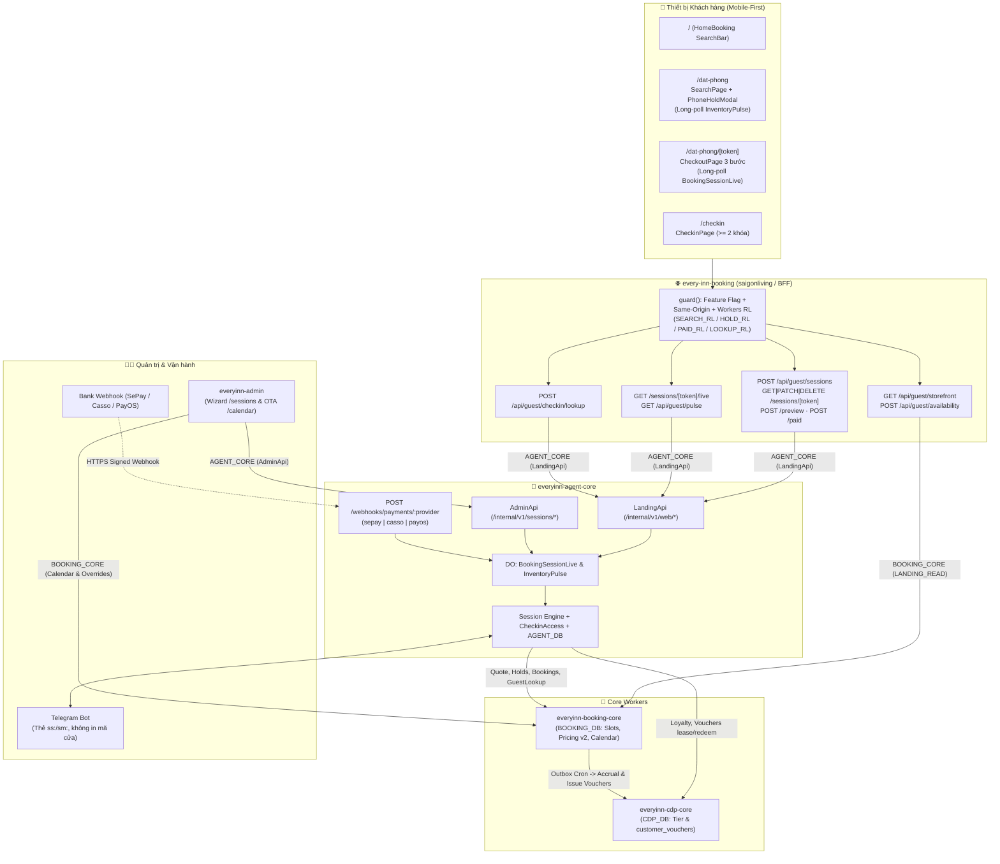
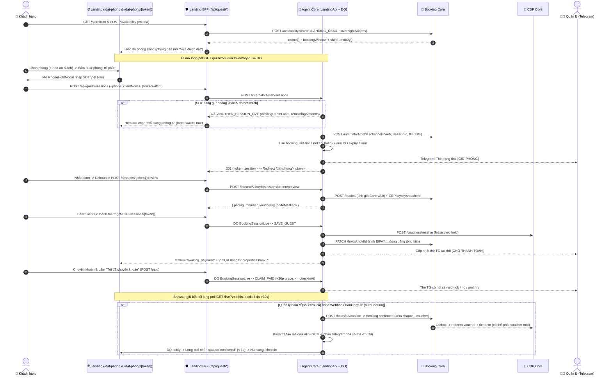

# Implementation Plan: Guest Self-Booking, Payment & Self Check-in Landing Page

- **Branch**: `feat/landing-self-booking` (Spec-Kit `001-guest-self-booking`)
- **Version**: 3.0.0 (Aligned 100% with [source-of-truth.md](./source-of-truth.md) and actual codebase)
- **Last Updated**: 2026-11-10
- **Spec**: [spec.md](./spec.md)
- **Target Services**:
  1. `every-inn-booking` (`saigonliving` / `saigonliving-dev` — Public Next.js 16 + OpenNext Worker on Cloudflare)
  2. `everyinn-booking-core` (Internal Booking Worker + `BOOKING_DB`)
  3. `everyinn-cdp-core` (Internal CDP & Voucher Wallet Worker + `CDP_DB`)
  4. `everyinn-agent-core` (Session Engine, Durable Objects, Payment Webhooks, Door-Code Vault & Telegram Ops + `AGENT_DB`)
  5. `everyinn-admin` (Unified Admin Session Wizard & OTA Calendar Extranet)
  6. `everyinn-platform-docs` (Contracts, Specs & `shared/booking-kit`)

---

## 1. Summary

Hệ thống **Tự đặt phòng, Thanh toán VietQR (Telegram 1-Tap & Payment Webhook Port) & Tra cứu Check-in (`/checkin`)** được triển khai theo kiến trúc thống nhất xung quanh **Booking Session Engine** (`everyinn-agent-core`), dùng chung cho cả **Khách tự đặt trên Landing** (`web`) và **Lễ tân trên Admin** (`admin`):

1. **Ranh giới Đọc / Ghi tách bạch (Decision D1)**:
   - `every-inn-booking` (`landing-bff`) chỉ gọi **`BOOKING_CORE` qua các route đọc** (`LANDING_READ`: `/storefront`, `/availability/search`, `/inventory/version`, `/quotes`, `/promotions/public`). Mọi thao tác **ghi phiên đặt phòng** và **tra cứu mã cửa `/checkin`** đi qua **`AGENT_CORE` entrypoint `LandingApi`** (`/internal/v1/web/*`, actor web `900002 / receptionist / Khách web`).
2. **Phone-First Hold & `/dat-phong/<token>` Capability URL (Decision D5, 2026-11-09)**:
   - Trên `/dat-phong` (`SearchPage.tsx`), bấm chọn phòng & `"Giữ phòng 10 phút"` sẽ mở `PhoneHoldModal` yêu cầu nhập SĐT Việt Nam trước khi tạo session.
   - Mỗi phiên có capability token 32 byte (`base64url`), DB chỉ lưu SHA-256 `token_hash`; tối đa **1 phiên sống / `phone_hash`** (có `409 ANOTHER_SESSION_LIVE` + 1 chạm `Đổi sang phòng` với `forceSwitch: true`) và **2 phiên sống / `ip_hash`**.
3. **Near-Realtime qua Durable Objects (Long-Poll 25s, Decision D3)**:
   - `BookingSessionLive` (mỗi phiên 1 actor chạy lệnh tuần tự + arm alarm hết hạn) phục vụ `/api/guest/sessions/[token]/live?v=&timeout=25000` — cập nhật `< 1s` sau khi Quản lý duyệt Telegram hoặc nhận webhook ngân hàng.
   - `InventoryPulse` (global DO) phục vụ `/api/guest/pulse?v=` để tự động làm mới kết quả tìm phòng, tô sáng phòng vừa đổi trạng thái và làm mờ phòng bận với nhãn `"Vừa được đặt"`. Client `useLongPoll` tự lùi về exponential backoff **4s → 30s** khi lỗi và tạm dừng khi tab ẩn.
4. **Core Pricing v2.0, Stacking Fix & Ví Voucher CDP (Decision D7)**:
   - Bước giờ nhận phòng theo giờ = **1 giờ chẵn (`:00`)** từ `08:00`–`21:00`, tối thiểu 3 giờ (`HOURLY_CHECKIN_STEP_INVALID` khi sai).
   - Thẻ phòng qua đêm trả về `overnightAddons` (`+1h/+2h/+3h nhận sớm` hoặc `trả muộn`, `60.000đ/giờ`) kiểm tra 2 chiều 60p turnover trong 1 query `inventory_slots`.
   - Công thức `stackDiscounts`: cả `promotionDiscount` lẫn voucher ví `customer_vouchers` (`TEM<step>-XXXX`) đều bị kẹp chặt trong `capBase = min(basePrice, subtotal)` — không trừ lấn vào phụ thu.
5. **Thanh toán mở rộng & Thẻ Telegram tại chỗ (Decision D2, D9)**:
   - Ngân hàng đọc động từ `BOOKING_DB.properties.bank_*`.
   - Thẻ Telegram dùng callback `ss:<sid>:ok|no|amt|rv|rv!|keep|short|topup|restore` và `sm:<inbox>:<sid>`, không bao giờ in plaintext mã cửa.
   - Endpoint `POST /webhooks/payments/:provider` (`sepay` | `casso` | `payos`) đặt trên **`everyinn-agent-core`** (public worker, trả `404` nếu chưa set secret).
6. **OTA Calendar Extranet & Unified Admin (Decision D11, D14, D15, D16)**:
   - `everyinn-admin` dùng chung Session Engine qua `AdminApi /internal/v1/sessions*` (Booking Core chặn `409 SESSION_MANAGED` nếu sửa hold của session bên ngoài).
   - Trang `/calendar` quản trị `rate_overrides` (migration `0011`), `POST /room-blocks/bulk` (tối đa 31 ngày, hỗ trợ `skipConflicts`) và `PUT /configs/booking_rules` (`max_advance_days`, tính theo **ngày dương lịch VN**; Web bị chặn `422 ADVANCE_BOOKING_EXCEEDED`, Admin nhận `warnings[]`).

---

## 2. Technical Context & Operational Metrics

| Thành phần | Đặc tả kỹ thuật & Số liệu vận hành |
| :--- | :--- |
| **Lưu lượng thực tế & Free Tier** | ~20 khách hỏi/ngày, ~120 bookings/tháng (~4 đơn/ngày), 50–150 lượt tìm kiếm/ngày. Nhờ DO long-poll (`~1 req / 25s`) + ETag `304`, tổng request toàn hệ thống ước tính `< 3%` quota Cloudflare Workers Free Tier (`100.000 req/ngày`, CPU `< 10ms/req`). |
| **Frontend & Public BFF** | Next.js `16.0.7` (App Router) + React `19.2.1` + TypeScript `5.9` (`strict: true`) + Tailwind CSS v4, build bằng `@opennextjs/cloudflare` (`saigonliving` / `saigonliving-dev`). |
| **Feature Flag Prod (Rule R6)** | `WEB_BOOKING_ENABLED = "false"` ở top-level prod (`saigonliving`) cho đến khi Owner duyệt go-live; `env.dev` (`saigonliving-dev`) bật `"true"`. Khi `false`, `/dat-phong` render `<BookingDisabled />` và API `/api/guest/*` trả `503 FEATURE_DISABLED`. |
| **Internal Core Workers & DOs** | `everyinn-booking-core`, `everyinn-cdp-core`, `everyinn-agent-core` (`AdminApi`, `LandingApi`, DO `BookingSessionLive` & `InventoryPulse`). Giao tiếp nội bộ qua Cloudflare Service Bindings (`x-ei-caller: landing-bff` / `admin-bff`). |
| **Databases (D1)** | `BOOKING_DB` (`booking-core`), `CDP_DB` (`cdp-core`), `AGENT_DB` (`agent-core`). |
| **Shared Kit (`everyinn-platform-docs`)** | `shared/booking-kit/{format,live,stay,types}.ts` được đồng bộ byte-identical sang `every-inn-booking/src/shared/booking-kit/` và `everyinn-admin/src/shared/booking-kit/` qua `scripts/sync-booking-kit.mjs`. |

---

## 3. Constitution & Platform Rules Check

- [x] **Rule 1 — Service Boundary & Least Privilege**: `landing-bff` chỉ được phép gọi `LANDING_READ` routes trên `BOOKING_CORE` và `LandingApi` trên `AGENT_CORE`. Mọi token được tạo ngẫu nhiên 32 byte, chỉ lưu SHA-256 `token_hash` trong `AGENT_DB`.
- [x] **Rule 2 — Server-Authoritative Re-derivation**: Client gửi tiêu chí (`kind`, `date`, `shift`, `start`, `hours`, `out`, `guests`); `every-inn-booking` `parseCriteria` + `criteriaStay` tự tính lại `checkinAt`/`checkoutAt` phía server, `BOOKING_CORE` tự tính giá và đóng băng tại hold/session.
- [x] **Rule 3 — Door-Code Vault Isolation (D9)**: Mã cổng và hộp khóa mã hóa AES-GCM trong `AGENT_DB`, chỉ giải mã khi `status === 'confirmed'` và nằm trong `[checkinAt - codesVisibleHoursBefore, checkoutAt + 2h]`; không gửi lên Telegram hay ghi log.
- [x] **Rule 4 — 10ms CPU & Indexed Batch Queries**: Nút thêm giờ qua đêm kiểm tra `[window_start, window_end]` bằng 1 batch query `inventory_slots`; toàn bộ thao tác `rate_overrides` & `room_blocks` dùng `db.batch()` và index có điều kiện.

---

## 4. Architecture & End-to-End Flow

### 4.1. Sơ đồ Kiến trúc Tổng thể (System Architecture)

### 4.2. Luồng Phone-First Hold, Thanh toán & Xác nhận (Sequence Diagram)

---

## 5. Thuật Toán Nghiệp Vụ & Bảo Mật Cốt Lõi

1. **Bước giờ nhận phòng theo giờ & Lead-Time**:
   - `hourlyStarts()` (`shared/booking-kit/stay.ts`) tạo danh sách giờ bước **60 phút (`:00`)** từ `firstCheckin` (`08:00`) đến `lastCheckin` (`21:00`), lọc `t >= nowMs + minLeadMinutes * 60_000` (mặc định 30 phút).
   - BFF `criteria.ts` kiểm tra regex `:00`; Core `stayRules.ts` kiểm tra `HOURLY_CHECKIN_STEP_INVALID` (`422`) và `LEAD_TIME_TOO_SHORT` (`422`).
2. **Overnight Add-ons & Bất biến 60p Dọn phòng 2 Chiều**:
   - Đọc 1 lần `inventory_slots` qua `slotsInWindow` trên toàn cửa sổ `[window_start, window_end + 60']` (mặc định `20:00`/`21:00` → `13:00` hôm sau).
   - `computeOvernightAddons` xét 2 làn `occupancy` và `turnover` cùng ngưỡng `nowMs`, đảm bảo liên tiếp (`IN_THE_PAST`, `SLOT_OCCUPIED`, `TURNOVER_BUFFER_CONFLICT`).
3. **Rolling Advance Window (`booking_rules.max_advance_days`)**:
   - Tính bằng **ngày dương lịch VN** qua `addBusinessDays(todayVn, max_advance_days)`. Ca qua đêm `24-12` bắt đầu `00:00` hôm sau tính `nightDate` là đêm trước (`overnightNightDate`). Chặn `422 ADVANCE_BOOKING_EXCEEDED` cho `landing-bff`/`agent-core`, còn `admin` nhận `warnings[]`.
4. **Rate Limiting 2 Lớp & Reconciler Fallback**:
   - Workers RL bảo vệ burst ngắn 60s ở edge; `AGENT_DB` giữ hạn mức dài hơn (1 live hold / `phone_hash`, 2 live holds / `ip_hash` web, 5 sai `/checkin` / 15p / `ipHash`).
   - Cron 5 phút / reconciler trên `everyinn-agent-core` xử lý hold hết hạn dự phòng khi DO alarm trễ, replay phiên kẹt ở `confirming > 60s` (`RESUME`), và kiểm tra nhắc cài mã cửa trước `checkinAt - codesVisibleHoursBefore`.

---

## 6. Cấu trúc File Đã Triển Khai (Verified File Map)

### 6.1. `everyinn-platform-docs`
- `shared/booking-kit/{format.ts,live.ts,stay.ts,types.ts}` — Source of Truth DTOs, stay helpers, long-poll hook (`useLongPoll`, `useServerCountdown`)
- `scripts/{sync-booking-kit.mjs,sync-contracts.mjs,uat-lsb-smoke.mjs,check-workers.mjs,check-workflows.mjs}`
- `CONVENTIONS.md`, `AGENT_INDEX.md`, `EI_LANDING_SELF_BOOKING_SPEC.md`, `EI_PHASE1_STATUS.md`, `EI_PROD_RELEASE_CHECKLIST.md`

### 6.2. `everyinn-booking-core`
- `migrations/`:
  - `0010_booking_sessions_channel.sql` (`channel`, `session_id`, `voucher_code`, `voucher_value`, `caller`, `external_ref`, `overnight_shifts`)
  - `0011_calendar_rates.sql` (`rate_overrides`, `room_blocks.block_type`)
- `src/`:
  - `domain/{pricing.ts,stayRules.ts,time.ts,promotions.ts}`
  - `handlers/{availability.ts,storefront.ts,holds.ts,calendar.ts,catalog.ts,blocks.ts,views.ts}`
  - `repo/{master.ts,slots.ts,bookings.ts,blocks.ts,audit.ts,financial.ts,outbox.ts}`
  - `services/{quote.ts,cdp.ts,loyalty-sync.ts}`, `lib/context.ts` (`landing-bff` caller), `routes.ts` (`LANDING_READ`)
- `test/`: `test/{bookings.spec.ts,calendar.spec.ts,callers.spec.ts,domain.spec.ts,lsb.spec.ts}`

### 6.3. `everyinn-cdp-core`
- `migrations/`: `0004_customer_vouchers.sql`
- `src/`: `domain/{rules.ts,stamps.ts}`, `handlers/{vouchers.ts,customers.ts,accrual.ts,outcomes.ts}`, `routes.ts`
- `test/`: `test/vouchers.spec.ts`

### 6.4. `everyinn-agent-core`
- `migrations/`: `0021_booking_sessions.sql`
- `src/`:
  - `index.ts` (expose `LandingApi`, `AdminApi`, `BookingSessionLive`, `InventoryPulse`, `POST /webhooks/payments/:provider`)
  - `cron.ts` (gọi `reconcileSessions`)
  - `masterdata/{defaults.ts,registry.ts}` (`SEED_VERSION = 11`: `booking_channels`, `checkin_guide`, `payment_policy`)
  - `sessions/{checkinAccess.ts,core.ts,http.ts,live.ts,machine.ts,notify.ts,payments.ts,policy.ts,reconcile.ts,repo.ts,service.ts,telegram.ts}`
  - `webhooks/telegram.ts` (định tuyến `ss:`/`sm:` & force-reply số tiền)
- `test/`: `test/{sessions.spec.ts,contract.spec.ts,masterdata.spec.ts,domain.spec.ts,entrypoints.spec.ts}`

### 6.5. `every-inn-booking` (Public Landing & BFF)
- `wrangler.jsonc` (`BOOKING_CORE`, `CDP_CORE`, `AGENT_CORE` `LandingApi`, `SEARCH_RL`, `HOLD_RL`, `PAID_RL`, `LOOKUP_RL`, `WEB_BOOKING_ENABLED`)
- `src/app/`:
  - `dat-phong/page.tsx`, `dat-phong/[token]/page.tsx`, `checkin/page.tsx`, `page.tsx`, `booking.css`
  - `api/guest/storefront/route.ts`, `api/guest/availability/route.ts`, `api/guest/pulse/route.ts`
  - `api/guest/sessions/route.ts`, `api/guest/sessions/[token]/route.ts`
  - `api/guest/sessions/[token]/{live,preview,paid}/route.ts`
  - `api/guest/checkin/lookup/route.ts`
- `src/components/`:
  - `booking/{HomeBooking.tsx,SearchBar.tsx,SearchPage.tsx,RoomResultCard.tsx,PhoneHoldModal.tsx,CheckoutPage.tsx,Disabled.tsx}`
  - `checkin/CheckinPage.tsx`, `Header.tsx`, `Footer.tsx`
- `src/lib/`: `booking/client.ts`, `server/{bff.ts,criteria.ts,storefront.ts,devMock.ts}`
- `src/shared/booking-kit/{format.ts,live.ts,stay.ts,types.ts}`
- `test/`: `test/{guestBooking.test.mjs,perfectCases.test.mjs,contract.test.mjs}`

### 6.6. `everyinn-admin` (Unified Engine & OTA Calendar Extranet)
- `wrangler.jsonc` (`AGENT_CORE` `AdminApi`, `BOOKING_CORE`, `CDP_CORE`)
- `src/app/calendar/page.tsx`, `src/app/dashboard/page.tsx`
- `src/app/api/`:
  - `calendar/matrix/route.ts`, `rate-overrides/{route.ts,clear/route.ts}`, `room-blocks/bulk/route.ts`, `configs/booking-window/route.ts`
  - `sessions/{route.ts,[id]/route.ts,[id]/[action]/route.ts,[id]/live/route.ts,by-hold/[holdId]/route.ts}`
- `src/components/`:
  - `bookings/checkout/{SessionPaymentPanel.tsx,sessionLabels.ts}`, `BookingWizard.tsx`
  - `calendar/{BookingWindowCard.tsx,RateOverrideDrawer.tsx,StopSellModal.tsx,types.ts}`
  - `dashboard/{HoldSessionDrawer.tsx,GanttHoldBar.tsx,GanttChart.tsx,BookingDetailDrawer.tsx}`
- `src/lib/{calendar.ts,sessions.ts,cores.ts,coreMappers.ts}`, `src/shared/booking-kit/*`
- `test/`: `test/{calendar.test.mjs,sessions.test.mjs,contract.test.mjs}`
