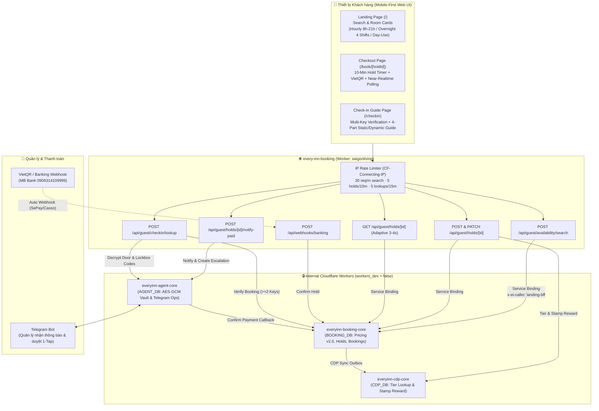
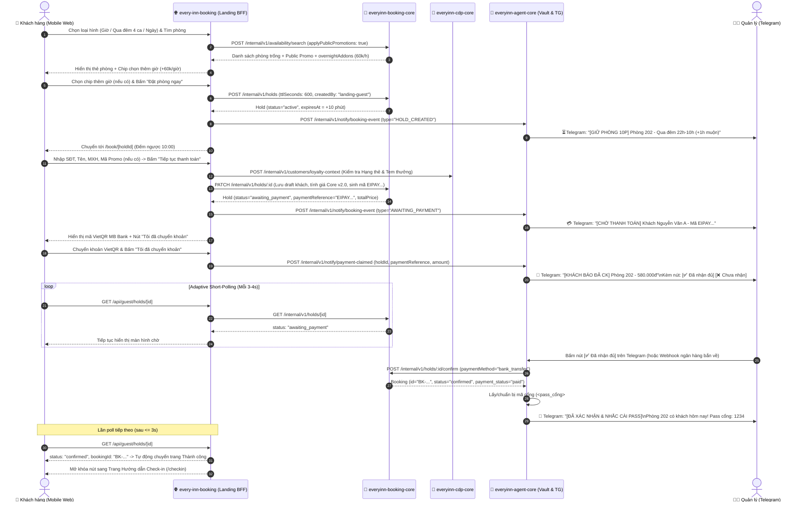

# Implementation Plan: Guest Self-Booking, Payment & Self Check-in Landing Page

- **Branch**: `001-guest-self-booking`
- **Date**: 2026-04-20
- **Version**: 2.0.0 (Updated to Core Pricing v2.0, Real-world Operational Metrics & Edge Security)
- **Last Updated**: 2026-11-08
- **Spec**: [spec.md](file:///Users/lap14666/Documents/private/every%20inn/van%20hanh/booking-page/every-inn-booking/specs/001-guest-self-booking/spec.md)
- **Target Services**:
  1. `every-inn-booking` (`saigonliving` — Public Next.js 16 + OpenNext Worker on Cloudflare)
  2. `everyinn-booking-core` (Internal Booking Worker + `BOOKING_DB`)
  3. `everyinn-cdp-core` (Internal CDP Worker + `CDP_DB`)
  4. `everyinn-agent-core` (Internal Door-Code Vault & Telegram Operations Worker + `AGENT_DB`)

---

## 1. Summary

Xây dựng hệ thống **Tự đặt phòng, Thanh toán VietQR (Xác nhận qua Telegram / Webhook) & Tra cứu Hướng dẫn Self Check-in (`/checkin`)** ngay trên Landing Page của Every Inn (`every-inn-booking`).

Giải pháp tận dụng kiến trúc Micro-Workers trên Cloudflare (thông qua **Service Bindings** độ trễ ~0ms, băng thông 0đ):
1. **Tìm phòng trực quan & Nút thêm giờ linh hoạt**: Mở rộng API tìm phòng trả về các nút mua thêm giờ nhận sớm/trả muộn trên từng thẻ phòng qua đêm theo đơn giá niêm yết **`60.000đ/giờ`** chỉ trong 1 truy vấn D1 duy nhất.
2. **Core Pricing v2.0 & Multi-Tier Promotions**: Áp dụng chuẩn công thức tính giá và stacking policy: $T_{\text{total}} = \max(0, P_{\text{base}} - D_{\text{promo}} - D_{\text{loyalty}}) + S_{\text{holiday}} + S_{\text{extra\_hours}} + S_{\text{extra\_guests}}$. Hỗ trợ cả khuyến mãi công khai (**Public**) và mã giảm giá (**Private**), kết hợp hạng thẻ thành viên CDP và quà tặng từ chu kỳ tích tem.
3. **Thanh toán VietQR & Near-Realtime**: Màn hình thanh toán hỗ trợ **Adaptive Short Polling (3–4s)** giúp cập nhật trạng thái tức thời khi Quản lý duyệt trên Telegram (hoặc ngân hàng bắn webhook).
4. **Bảo mật & Rate Limit theo IP**: Sử dụng `CF-Connecting-IP` với cơ chế sliding window rate limiting chống bot cào quét lịch, flood giữ phòng rác và brute-force tra cứu mã khóa.
5. **Không dùng AI Chatbot**: Luồng đặt phòng hoàn toàn tự phục vụ qua Web UI; Telegram bot chỉ làm nhiệm vụ gửi thông báo và nút duyệt cho Quản lý (Human Manager).
6. **Quản trị Lịch phòng & Giá bán kiểu OTA (Calendar Extranet)**: Cung cấp giao diện ma trận phòng / ngày cho Admin chủ động Đóng / Mở bán (Stop-Sell / Room Blocks), Điều chỉnh giá trực tiếp (Dynamic Daily Rate Overrides) cho từng ngày/hạng phòng/ca, và cấu hình Cửa sổ nhận đặt phòng trước luân phiên (Rolling Advance Booking Window: 2 tháng, 3 tháng, 6 tháng, 1 năm) tự động dời mỗi ngày.

---

## 2. Technical Context & Operational Metrics

| Thành phần | Đặc tả kỹ thuật & Số liệu thực tế |
| :--- | :--- |
| **Quy mô Vận hành Thực tế** | - Lượng khách nhắn fanpage/zalo: **~20 khách/ngày**.<br>- Số booking hoàn tất trung bình: **~120 bookings/tháng** (~4 bookings/ngày).<br>- Lượt tìm kiếm phòng suy ra: **~50 – 150 lượt/ngày** (cao điểm 19h–23h khoảng 20–40 lượt/giờ). |
| **Cloudflare Free Tier Quota** | - **100.000 requests/ngày** và CPU limit **10ms/invocation**.<br>- Tổng lưu lượng hệ thống (bao gồm cả near-realtime short polling) chỉ tốn **~1.500 – 3.000 requests/ngày** (< 3% quota), hoàn toàn an toàn và không lo cạn kiệt tài nguyên. |
| **Frontend & Public BFF** | Next.js 16 (App Router) + React 19 + TypeScript 5 (`strict: true`) + Tailwind CSS v4, biên dịch qua `@opennextjs/cloudflare` chạy trên Cloudflare Workers (`saigonliving`). |
| **Internal Core Services** | Cloudflare Workers (`everyinn-booking-core`, `everyinn-cdp-core`, `everyinn-agent-core`) với `workers_dev = false`, giao tiếp nội bộ qua **Cloudflare Service Bindings** (`env.BOOKING_CORE`, `env.CDP_CORE`, `env.AGENT_CORE`). |
| **Database** | Cloudflare D1 (SQLite): `BOOKING_DB` (lịch phòng, holds, bookings, promotions), `CDP_DB` (khách hàng, hạng thẻ, tích tem), `AGENT_DB` (mã cửa AES-GCM, Telegram escalations). |
| **Media Storage** | 2 Hình ảnh hướng dẫn checkin/checkout & video đường đi đầu hẻm 71/31 phục vụ qua Static Assets (`public/checkin-guide/`) với `preload="metadata"` và `playsInline`. |

---

## 3. Constitution & Platform Rules Check

Thiết kế này tuân thủ 100% các quy tắc kiến trúc trong `everyinn-platform-docs/CONVENTIONS.md` và `rules/cloudflare-free-tier.md`:

- [x] **Rule 1 — Service Boundary & Caller Auth**: `every-inn-booking` không truy cập trực tiếp vào DB của các Worker khác. Mọi thao tác đi qua Service Bindings với header `x-ei-caller: landing-bff` và `x-request-id: <uuid>`.
- [x] **Rule 2 — Server-Authoritative Pricing v2.0**: Frontend tuyệt đối không tự tính giá chốt. Mọi giá cơ bản, phụ thu thêm giờ (`60.000đ/giờ`), phụ thu khách thứ 3 Signature (`150.000đ/khách`), phụ thu lễ và chiết khấu (Public Promo / Private Promo / CDP Loyalty Tier / Stamp Reward) đều do `everyinn-booking-core` tính toán và đóng băng (snapshot) khi tạo Hold.
- [x] **Rule 3 — Door-Code Vault Isolation**: Mã cổng (`<pass_cổng>#`) và mã hộp khóa (`<pass lock box>`) chỉ nằm trong `AGENT_DB` (mã hóa AES-GCM). Không bao giờ lưu vào `BOOKING_DB` hay log ra console.
- [x] **Rule 4 — 10ms CPU & Indexed Batch Queries**: Kiểm tra các nút thêm `1h/2h/3h` checkin sớm và checkout muộn cho cả 6 phòng Qua đêm được gom vào **1 câu truy vấn `inventory_slots` duy nhất** trong `everyinn-booking-core`, xử lý trên bộ nhớ trong `< 1ms` CPU.

---

## 4. Architecture & End-to-End Flow

### 4.1. Sơ đồ Kiến trúc Tổng thể (System Architecture)



### 4.2. Luồng Đặt phòng, Thanh toán & Tự động Chuẩn bị Mã phòng (Sequence Diagram)



---

## 5. Thuật toán Hiển thị Nút Thêm Giờ Qua Đêm (`overnightAddons`)

### 5.1. Ma trận Giới hạn Số Nút Theo Ca (`SHIFT_ADDON_CAPS`)
Mọi ca qua đêm cộng thêm giờ nhận sớm / trả muộn đều nằm trong khung biên từ **21:00 tối hôm trước** đến **12:00 trưa hôm sau**, đơn giá cố định **`60.000đ/giờ`**:

```typescript
export const OVERNIGHT_SHIFT_CAPS = {
  '21-9':  { baseStartHour: 21, baseEndHour: 9,  maxEarlyHours: 0, maxLateHours: 3 }, // Tối đa +1h, +2h, +3h checkout muộn (10h, 11h, 12h)
  '22-10': { baseStartHour: 22, baseEndHour: 10, maxEarlyHours: 1, maxLateHours: 2 }, // Tối đa +1h checkin sớm (21h); +1h, +2h checkout muộn (11h, 12h)
  '23-11': { baseStartHour: 23, baseEndHour: 11, maxEarlyHours: 2, maxLateHours: 1 }, // Tối đa +1h, +2h checkin sớm (22h, 21h); +1h checkout muộn (12h)
  '24-12': { baseStartHour: 24, baseEndHour: 12, maxEarlyHours: 3, maxLateHours: 0 }, // Tối đa +1h, +2h, +3h checkin sớm (23h, 22h, 21h)
} as const;

export const OVERNIGHT_EXTRA_HOUR_FEE = 60_000; // VNĐ / giờ
```

### 5.2. Kiểm tra Lịch Trống Thực Tế trong 1 Truy Vấn D1 Duy Nhất
Khi khách tìm phòng Qua đêm cho ngày $D$ với ca $S$:
1. `everyinn-booking-core` mở rộng cửa sổ đọc `inventory_slots` ra toàn khung qua đêm mở rộng $[20:00 \text{ ngày } D, 13:00 \text{ ngày } D+1)$ (từ `21:00 - 60p turnover` đến `12:00 + 60p turnover`, chỉ 34 slot 30 phút cho mỗi phòng).
2. Với mỗi phòng trống ca cơ bản $[T_{\text{in}}, T_{\text{out}})$:
   - **Kiểm tra Nhận sớm (`+e giờ`, $1 \le e \le \text{maxEarlyHours}$)**: Toàn bộ slot trong $[T_{\text{in}} - e\text{h} - 60\text{p turnover}, T_{\text{in}})$ phải trống. Bị vướng ở bậc $e$ thì dừng kiểm tra các bậc lớn hơn.
   - **Kiểm tra Trả muộn (`+l giờ`, $1 \le l \le \text{maxLateHours}$)**: Toàn bộ slot trong $[T_{\text{out}}, T_{\text{out}} + l\text{h} + 60\text{p turnover})$ phải trống. Bị vướng ở bậc $l$ thì dừng kiểm tra.
3. Payload trả về đính kèm trong từng phòng:
   ```json
   "overnightAddons": {
     "shift": "22-10",
     "ruleMaxEarlyHours": 1,
     "ruleMaxLateHours": 2,
     "availableEarlyHours": [1],
     "availableLateHours": [1, 2],
     "surchargePerHour": 60000
   }
   ```
4. Khi khách chọn chip trên UI, giá phòng tự động cộng thêm `(earlyHours + lateHours) * 60.000đ` và gửi thẳng vào `POST /api/guest/holds`.

### 5.3. Bất Biến 60 Phút Dọn Phòng Hai Chiều (Bidirectional 60-Minute Turnover Invariant)
Dù là tìm phòng giờ, ngày, ca qua đêm cơ bản hay chọn thêm giờ sớm/muộn, hệ thống luôn tuân thủ nguyên lý bảo vệ 2 chiều:

1. **Chiều Ca Trước $\rightarrow$ Ca Sau**:
   - Nếu ca trước kết thúc lúc $T_{\text{out}}^{(1)}$, hệ thống khóa làn turnover $[T_{\text{out}}^{(1)},\; T_{\text{out}}^{(1)} + 60']$.
   - Ca sau chỉ được phép nhận phòng sớm nhất lúc:
     $$T_{\text{in}}^{(2)} \ge T_{\text{out}}^{(1)} + 60\text{ phút}$$
2. **Chiều Ca Sau $\leftarrow$ Ca Trước**:
   - Nếu ca sau đã đặt nhận phòng lúc $T_{\text{in}}^{(2)}$, buồng phòng cần 60 phút dọn dẹp trước đó $[T_{\text{in}}^{(2)} - 60',\; T_{\text{in}}^{(2)}]$.
   - Ca trước bắt buộc phải trả phòng muộn nhất lúc:
     $$T_{\text{checkout}}^{(1)} \le T_{\text{in}}^{(2)} - 60\text{ phút}$$
3. **Hai ca liên tiếp luôn đảm bảo cách nhau tối thiểu 60 phút**:
   $$\Delta T = T_{\text{in}}^{(2)} - T_{\text{out}}^{(1)} \ge 60\text{ phút}$$
   Nhờ kiến trúc 2 lanes (`occupancy` và `turnover`) trong bảng `inventory_slots`, câu truy vấn kiểm tra của Core tự động phát hiện xung đột cả 2 chiều trong đúng 1 lệnh `SELECT` duy nhất.

---

## 6. Cơ Chế Tính Giá & Chính Sách Ưu Đãi Multi-Tier (Core v2.0)

Frontend ủy quyền toàn bộ phép tính giá cho Backend Core theo công thức:
$$T_{\text{total}} = \max\Big(0,\; P_{\text{base}} - D_{\text{promo}} - D_{\text{loyalty}}\Big) + S_{\text{holiday}} + S_{\text{extra\_hours}} + S_{\text{extra\_guests}}$$

### 6.1. Chi Tiết Các Cấu Phần
- **$P_{\text{base}}$ (Base Price)**:
  - Haven: Combo 3h = `320.000đ`, Qua đêm = `520.000đ`, Theo ngày = `620.000đ/đêm`.
  - Signature: Combo 3h = `360.000đ`, Qua đêm = `620.000đ`, Theo ngày = `750.000đ/đêm`.
- **$D_{\text{promo}}$ (Chiến dịch Khuyến mãi)**:
  - **Public Promo (`is_public = 1`)**: Tự động tìm và áp dụng mức giảm tốt nhất trong kết quả tìm phòng mà không cần nhập mã.
  - **Private Promo Code (`is_public = 0`)**: Khách nhập mã code trên form thanh toán để áp dụng.
  - **Bắt buộc**: $D_{\text{promo}}$ chỉ được tính trên $P_{\text{base}}$ (hoặc $P_{\text{base}}$ các đêm đủ điều kiện), không giảm trên phụ thu.
- **$D_{\text{loyalty}}$ (Hội viên & Tích tem CDP)**:
  - Tra cứu theo SĐT: Xác định hạng thẻ (`bronze`, `silver`, `gold`) và phần thưởng tích tem (`rewardValue: 50k, 100k, 150k`).
  - Áp dụng trên phần giá cơ bản còn lại: $D_{\text{loyalty}} \le P_{\text{base}} - D_{\text{promo}}$.
- **$S_{\text{holiday}}$**: Phụ thu ngày lễ theo đêm/ca từ `surcharge_rules`.
- **$S_{\text{extra\_hours}}$**: `(earlyHours + lateHours + extraComboHours) * 60.000đ`.
- **$S_{\text{extra\_guests}}$**: `(numGuests - 2) * 150.000đ * stayUnits` (Chỉ áp dụng Signature 3-4 khách).

---

## 7. Giải Pháp Near-Realtime, Security & Rate Limiting

### 7.1. Phân Tích Tải & Tính Khả Thi Near-Realtime
- **Traffic thực tế**:
  - ~20 khách hỏi/ngày $\rightarrow$ ~120 bookings/tháng $\approx$ 4 bookings/ngày.
  - Tìm phòng: 50 – 150 lượt/ngày.
  - Polling khi thanh toán: Khách chờ duyệt trung bình 30s – 120s $\rightarrow$ Polling 3s/lần tốn ~10 – 40 requests/đơn. Với 4 đơn/ngày, tổng lượng request polling chỉ ~160 – 600 req/ngày.
- **Cloudflare Free Tier Quota**: Cung cấp **100.000 requests/ngày**. Tổng tải của Every Inn chỉ chiếm **~1.5% – 3% quota**, hoàn toàn dư địa để chạy near-realtime short-polling mượt mà mà không lo nghẽn hoặc vượt chi phí.

### 7.2. Edge Rate Limiter (`rateLimit.ts`)
Áp dụng Sliding Window In-Memory / KV Rate Limiter tại lớp BFF:
```typescript
// Các hạn mức bảo vệ căn bản theo IP (CF-Connecting-IP)
export const RATE_LIMITS = {
  SEARCH:      { limit: 30, windowSec: 60 },  // 30 req / phút / IP
  CREATE_HOLD: { limit: 5,  windowSec: 600 }, // 5 holds / 10 phút / IP (chống chiếm phòng ảo)
  NOTIFY_PAID: { limit: 5,  windowSec: 60 },  // 5 req / phút / hold
  CHECKIN:     { limit: 5,  windowSec: 900 }, // 5 lần thử sai / 15 phút / IP (chống dò mã)
};
```
Nếu vượt quá hạn mức, trả về ngay HTTP `429 Too Many Requests` kèm header `Retry-After`.

---

## 8. Kế Hoạch File Changes & Refactoring

### 8.1. `everyinn-booking-core` (Internal Booking Worker)
```text
everyinn-booking-core/
├── migrations/
│   └── 0005_calendar_rate_overrides.sql   # [NEW] DDL bảng calendar_rate_overrides & index
├── src/
│   ├── lib/
│   │   └── context.ts                     # Bổ sung caller 'landing-bff' vào KNOWN_CALLERS
│   ├── domain/
│   │   ├── overnightAddons.ts             # Logic tính nút +1h/2h/3h sớm/muộn 4 ca theo giá 60.000đ/giờ
│   │   ├── pricing.ts                     # Tích hợp calendar_rate_overrides vào Core Pricing v2.0
│   │   └── bookingRules.ts                # [NEW] Kiểm tra Rolling Advance Booking Window (max_advance_days)
│   ├── handlers/
│   │   ├── availability.ts                # Mở rộng trả về overnightAddons trong POST /availability/search
│   │   ├── guestBookingLookup.ts          # POST /internal/v1/bookings/guest-lookup (xác thực >= 2 keys)
│   │   ├── calendar.ts                    # [NEW] GET /internal/v1/calendar/matrix (Ma trận phòng/ngày)
│   │   └── rateOverrides.ts               # [NEW] POST & DELETE /internal/v1/calendar/rate-overrides
│   └── routes.ts                          # Đăng ký routes nội bộ mới
```

### 8.2. `everyinn-agent-core` (Door-Code Vault & Telegram Bot Worker)
```text
everyinn-agent-core/
├── src/
│   ├── handlers/
│   │   ├── landingNotifications.ts        # Gửi thông báo Telegram mọi trạng thái kèm Inline Buttons
│   │   └── guestCheckinAccess.ts          # Chuẩn bị trước pass cổng/hộp khóa, nhắc Quản lý cài pass
│   ├── flows/
│   │   └── confirm.ts                     # Xử lý Telegram callback lpcf:<holdId> -> Gọi Core confirmHold
│   └── index.ts                           # Expose routes nội bộ qua Service Binding cho landing-bff
```

### 8.3. `every-inn-booking` (Public Landing Page & Guest BFF)
```text
every-inn-booking/
├── wrangler.jsonc                         # Bổ sung Service Bindings: BOOKING_CORE, CDP_CORE, AGENT_CORE
├── public/
│   └── checkin-guide/                     # Media hướng dẫn checkin/checkout + video đường đi đầu hẻm
├── src/
│   ├── lib/
│   │   ├── server/
│   │   │   ├── coreClients.ts             # Typed Service Binding clients (x-ei-caller: landing-bff)
│   │   │   ├── rateLimit.ts               # IP-based sliding window rate limiter (CF-Connecting-IP)
│   │   │   └── telegramNotify.ts          # Gửi sự kiện sang AGENT_CORE
│   │   └── booking/
│   │       ├── overnightRules.ts          # Cấu hình 4 ca qua đêm & đơn giá 60k/giờ
│   │       ├── advanceBookingRules.ts     # [NEW] Giới hạn ngày chọn trên DatePicker theo max_advance_days
│   │       └── checkinTemplate.ts         # Template 4 phần chuẩn & hàm thay thế biến an toàn
│   ├── app/
│   │   ├── api/
│   │   │   ├── guest/
│   │   │   │   ├── availability/search/route.ts       # Tìm phòng + Giá KM + Overnight Add-ons (kiểm tra max_advance_days)
│   │   │   │   ├── promotions/validate/route.ts       # Kiểm tra mã giảm giá + Hạng thẻ CDP
│   │   │   │   ├── holds/route.ts                     # Tạo giữ phòng 10 phút (chặn ngày ngoài advance window)
│   │   │   │   ├── holds/[id]/route.ts                # Lấy trạng thái Hold (phục vụ Polling 3-4s)
│   │   │   │   ├── holds/[id]/notify-paid/route.ts    # Báo đã chuyển khoản -> Telegram Quản lý
│   │   │   │   └── checkin/lookup/route.ts            # Tra cứu hướng dẫn check-in (>= 2 keys)
│   │   │   └── webhooks/
│   │   │       └── banking/route.ts                   # Webhook SePay/Casso/PayOS
│   │   ├── book/[holdId]/page.tsx                     # Trang Checkout + Đếm ngược 10p + VietQR + Near-realtime Polling
│   │   └── checkin/page.tsx                           # Trang Landing Page Hướng dẫn Check-in (4 phần cố định)
│   └── components/
│       ├── booking/
│       │   ├── AgodaSearchBar.tsx                     # Search widget 3 tab (Vô hiệu hóa ngày vượt max_advance_days)
│       │   ├── AvailableRoomGrid.tsx                  # Lưới phòng trống
│       │   ├── InteractiveRoomCard.tsx                # Thẻ phòng có Carousel + Nút thêm giờ (+60k/h)
│       │   ├── HoldCountdownBanner.tsx                # Thanh đếm ngược 10:00
│       │   ├── GuestCheckoutForm.tsx                  # Form thông tin + Tự nhận diện CDP + Mã KM
│       │   └── VietQRPaymentPanel.tsx                 # Mã VietQR MB Bank + Live Polling 3-4s
│       └── checkin/
│           ├── CheckinLookupForm.tsx                  # Form nhập >= 2 khóa xác thực
│           └── CheckinGuideView.tsx                   # Giao diện 4 phần chuẩn + One-Tap Copy
```

### 8.4. `everyinn-admin` (Quản Trị Lịch Phòng & Giá Bán OTA Extranet)
```text
everyinn-admin/
├── src/
│   ├── app/
│   │   └── calendar/
│   │       └── page.tsx                       # [NEW] Ma trận Lịch phòng kiểu OTA (ngày x phòng)
│   └── components/
│       └── calendar/
│           ├── CalendarMatrixView.tsx         # [NEW] Lưới ô hiển thị Giá bán, Tình trạng (Mở/Đóng/Kẹt), Override
│           ├── StopSellActionModal.tsx        # [NEW] Modal Đóng/Mở bán nhanh cho 1 ngày hoặc dải ngày/giờ
│           ├── DynamicRateOverrideDrawer.tsx  # [NEW] Drawer chỉnh sửa giá bán trực tiếp theo ngày/ca
│           └── RollingAdvanceWindowConfig.tsx # [NEW] Cấu hình số tháng/ngày nhận trước tối đa (2m, 3m, 6m, 1y)
```

---

## 9. Quản Trị Lịch Phòng & Giá Bán Kiểu OTA (Calendar Extranet)

Hệ thống bổ sung năng lực quản trị tương tự Extranet của các sàn OTA (Agoda YCS / Booking.com Pulse / Airbnb Host Calendar) trực tiếp trên nền Cloudflare Workers và D1:

### 9.1. Đóng / Mở Bán Chủ Động (Stop-Sell & Room Blocks)
- **Cơ chế**: Admin có thể đóng bán tức thời cho 1 phòng cụ thể hoặc toàn bộ cơ sở trong 1 ngày, nhiều ngày hoặc khung giờ nhất định thông qua bảng `room_blocks`.
- **Lý do chuẩn hóa**: `'stop_sell'` (chủ động đóng bán OTA/Direct), `'maintenance'` (bảo trì thiết bị), `'owner_stay'` (chủ nhà ở), `'deep_cleaning'` (tổng vệ sinh định kỳ).
- **Tính toán khả dụng**: Khi có block hiệu lực trên phòng $R$ tại khoảng thời gian $[T_1, T_2]$, `everyinn-booking-core` tự động coi toàn bộ slot trong khoảng này (và buffer 60 phút trước/sau) là không khả dụng (`available = false`), ngăn khách đặt trên Landing Page.

### 9.2. Điều Chỉnh Giá Trực Tiếp Trên Calendar (`calendar_rate_overrides`)
- **Bảng D1 mới**: `calendar_rate_overrides` lưu trữ giá bán tùy chỉnh ghi đè theo `(property_id, room_class / room_id, rate_plan_code, override_date)`.
- **Tích hợp Core Pricing v2.0**:
  1. Khi tính giá cho một ngày lưu trú, hệ thống kiểm tra bảng `calendar_rate_overrides` trước.
  2. Nếu tồn tại bản ghi override hợp lệ (`is_active = 1`), giá trị `custom_base_price` sẽ **thay thế trực tiếp** cho $P_{\text{base}}$ niêm yết trong bảng `rate_rules`.
  3. Tất cả các chính sách giảm giá (Public Promotion, Private Promo Code, Chiết khấu Hạng thẻ CDP, Quà tặng tích tem) sẽ được tính toán dựa trên mức $P_{\text{base}}$ đã ghi đè này:
     $$T_{\text{total}} = \max\Big(0,\; P_{\text{base}}^{(\text{overridden})} - D_{\text{promo}} - D_{\text{loyalty}}\Big) + S_{\text{holiday}} + S_{\text{extra\_hours}} + S_{\text{extra\_guests}}$$
  4. Đơn giá thêm giờ `$60.000đ/giờ$` và phụ thu khách thứ 3 Signature `$150.000đ/khách$` vẫn giữ nguyên độc lập.

### 9.3. Cửa Sổ Nhận Đặt Phòng Trước Luân Phiên (Rolling Advance Booking Window)
- **Yêu cầu nghiệp vụ**: Cho phép home nhận đặt trước tối đa trong một khoảng thời gian xác định (ví dụ: **2 tháng, 3 tháng [mặc định], 6 tháng, hoặc 1 năm**) và **tự động tịnh tiến (roll forward)** liên tục theo từng ngày mà không cần admin thao tác thủ công.
- **Tham số cấu hình**: Lưu trong `booking_configs.max_advance_days` (mặc định: `90` ngày tương đương 3 tháng; các mốc nhanh: 60 ngày, 90 ngày, 180 ngày, 365 ngày).
- **Thuật toán Luân phiên Ngày (Rolling Day Invariant)**:
  - Lấy ngày hiện tại tại múi giờ Việt Nam (`Asia/Ho_Chi_Minh`): $D_{\text{today}}$.
  - Mốc ngày xa nhất được phép đặt phòng:
    $$D_{\text{max\_allowed}} = \text{addDays}(D_{\text{today}},\; \text{max\_advance\_days})$$
  - Vào lúc `00:00:00` mỗi ngày (giờ VN), $D_{\text{today}}$ tăng thêm 1 ngày $\rightarrow D_{\text{max\_allowed}}$ tự động tịnh tiến thêm 1 ngày theo thời gian thực (Zero-cron, Zero-maintenance).
- **Kiểm soát 2 Lớp (Two-Layer Enforcement)**:
  1. **Lớp Giao diện (Landing Page DatePicker)**: Vô hiệu hóa (disable) tất cả các ngày $> D_{\text{max\_allowed}}$ trên lịch tìm kiếm phòng. Khách không thể nhấp chọn ngày vượt quá cửa sổ.
  2. **Lớp Server-Authoritative (`BOOKING_CORE`)**: Khi nhận request tìm phòng hoặc tạo Hold với `checkinDate > D_{\text{max\_allowed}}`, Core từ chối ngay với mã lỗi chuẩn `422 ADVANCE_BOOKING_EXCEEDED` kèm thông báo tiếng Việt: *"Hệ thống hiện chỉ mở nhận đặt phòng trước tối đa ${max_advance_days} ngày. Vui lòng chọn ngày trong khoảng cho phép."*
```
